<picture>
  <source media="(prefers-reduced-motion: reduce)" srcset="./docs/assets/film-still.svg">
  
</picture>

<picture>
  <source media="(prefers-reduced-motion: reduce)" srcset="./docs/assets/stats-still.svg">
  
</picture>

<p>
  <a href="https://mirhamzahasan.github.io/longhorn/"><b>Website</b></a> &nbsp;|&nbsp;
  <a href="#start-in-a-minute"><b>Quickstart</b></a> &nbsp;|&nbsp;
  <a href="#how-it-fits-together"><b>How it works</b></a> &nbsp;|&nbsp;
  <a href="#find-your-way-around-the-docs"><b>Docs</b></a> &nbsp;|&nbsp;
  <a href="#contribute"><b>Contribute</b></a> &nbsp;|&nbsp;
  <a href="https://github.com/MirHamzaHasan/longhorn/discussions"><b>Discussions</b></a>
</p>

[](https://github.com/MirHamzaHasan/longhorn/actions/workflows/verify.yml)


[](CONTRIBUTING.md)

**Write once. Run on Node, Bun, Deno or Workers.**

LongHorn is a modular TypeScript backend framework on [Hono](https://hono.dev) and Web
Standards. Your app runs on Node, Bun, Deno or Cloudflare Workers, using each platform's
own server. Add only the modules you use: database, auth, queues, schedules, outbox
delivery, rate limits, caching and observability.

> [!IMPORTANT]
> **Early alpha.** LongHorn is on npm, but it has not been deployed to production, and its
> APIs can still change.
> See [what is and isn't tested](#what-is-and-isnt-tested).

## Why LongHorn exists

Most backends are fine until something fails at the wrong moment. The database commits,
then the process dies before the message goes out. A client times out and retries, and
the payment runs twice. A deploy kills a job halfway through. These bugs are hard to
reproduce, so they tend to be found in production.

LongHorn makes that failure handling part of the framework, and tests it by actually
causing the failure: killing processes, dropping replies and running concurrent writers
against real databases.

It is built on three decisions:

- **Nothing happens implicitly.** Core installs no database, auth or queue. Your
  application imports each module and wires it, so you can read how your app starts.
- **Portable where it can be, native where it counts.** Shared code uses `Request` and
  `Response`. Each host uses its own server, SQLite and crypto instead of an imitation.
- **The application owns its lifetime.** Resources start in order. On shutdown, accepted
  work finishes before the resources it borrowed are released.

### Is it right for you?

| Worth trying if you | Wait if you need |
| --- | --- |
| Want to read and shape a backend framework early | A stable API |
| Care about what happens when a process dies mid-request | A framework already proven in production |
| Already like Hono and want structure around it | Password reset or MFA out of the box |
| Want one app model across Node, Bun, Deno and Workers | Generated CRUD, an admin panel or an ORM |

<picture>
  <source media="(prefers-reduced-motion: reduce)" srcset="./docs/assets/divider-still.svg">
  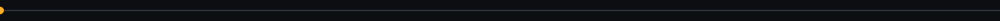
</picture>

## Start in a minute

You need Node 20.19 or newer and [pnpm](https://pnpm.io) 12.6.

<picture>
  <source media="(prefers-reduced-motion: reduce)" srcset="./docs/assets/quickstart-still.svg">
  
</picture>

```sh
npm create longhorn@latest my-api -- --runtime node
cd my-api
pnpm install
pnpm dev
```

```sh
curl http://127.0.0.1:3000/health
# {"status":"ok","runtime":"node","ready":true}
```

The new project is yours. It has its own copy of the framework, plus tests and guides,
and it works outside this repository.

### Choose a starting point

| You are building | Create it with | Guide |
| --- | --- | --- |
| An HTTP API | `npm create longhorn@latest my-app -- --runtime node`, or `bun`, `deno`, `workers` | [Templates](docs/starter-templates.md) |
| An app with a database | `pnpm create:app ../my-app --runtime node --template sqlite-tasks`, or `bun`, `deno` | [SQLite starter](docs/sqlite-starter.md) |
| An app with accounts | `pnpm create:app ../my-app --runtime node --template sqlite-auth`, or `bun`, `deno` | [Auth starter](docs/auth-starter.md) |
| A Worker with storage | `pnpm create:app ../my-app --runtime workers --template d1-tasks` | [D1 starter](docs/d1-starter.md) |
| The complete console | `pnpm create:app ../my-app --runtime node --template command-app`, which needs PostgreSQL | [Command project](docs/command-project.md) |

`--template` does not work from the npm 0.1.0 packages yet, so `pnpm create:app` runs from a clone of this repository, after `pnpm install`.

<picture>
  <source media="(prefers-reduced-motion: reduce)" srcset="./docs/assets/divider-still.svg">
  
</picture>

## Your first app

<picture>
  <source media="(prefers-reduced-motion: reduce)" srcset="./docs/assets/firstapp-still.svg">
  
</picture>

Here's a slightly bigger one, with a service in the container:

```ts
import { Longhorn } from '@longhornjs/core'
import { provide, token } from '@longhornjs/container'
import { nodeRuntime } from '@longhornjs/node'

const Greeting = token<{ say(name: string): string }>('greeting')
const app = new Longhorn()

app.container.register(provide(Greeting, {
  factory: () => ({ say: (name) => `Hello, ${name}` }),
}))

app.http.get('/hello/:name', (c) => {
  const greeting = c.get('container').resolve(Greeting)
  return c.json({ message: greeting.say(c.req.param('name')) })
})

const server = await app.listen(nodeRuntime, { port: 3000 })
console.log(server.url)
```

`app.http` is the real Hono app, so Hono routers and middleware work directly. To change
host, change the import and the last line:

<picture>
  <source media="(prefers-reduced-motion: reduce)" srcset="./docs/assets/hosts-still.svg">
  
</picture>

| Host | Import | Start with | Storage |
| --- | --- | --- | --- |
| [Node](docs/runtimes.md) | `nodeRuntime` from `@longhornjs/node` | `app.listen(nodeRuntime)` | SQLite, PostgreSQL, Redis |
| [Bun](docs/bun.md) | `bunRuntime` from `@longhornjs/bun` | `app.listen(bunRuntime)` | Native `bun:sqlite` |
| [Deno](docs/deno.md) | `denoRuntime` from `@longhornjs/deno` | `app.listen(denoRuntime)` | Built-in SQLite |
| [Workers](docs/workers.md) | `createWorker` from `@longhornjs/workers` | `export default createWorker(app)` | D1, Durable Object SQLite |

Not every module runs everywhere. The [runtime matrix](docs/supported-runtimes.md) lists
exactly what was verified on each host.

<picture>
  <source media="(prefers-reduced-motion: reduce)" srcset="./docs/assets/divider-still.svg">
  
</picture>

## How it fits together

Your application sits on top. It picks modules, and it picks a host to run on.

<picture>
  <source media="(prefers-reduced-motion: reduce)" srcset="./docs/assets/stack-still.svg">
  
</picture>

The animation reads each example's real `package.json`, so what lights up is what that
app imports.

A command in the complete example application takes this path:

<picture>
  <source media="(prefers-reduced-motion: reduce)" srcset="./docs/assets/journey-still.svg">
  
</picture>

<details>
<summary>Read the path as text</summary>

1. The console sends a command to a Hono route, which authenticates and validates it.
2. Idempotency makes a retried request return the original reply instead of running again.
3. One SQL transaction saves the command and its outgoing message together.
4. A dispatcher delivers the message over HTTP, and retries until it lands or attempts run out.
5. The receiver stores one result per message ID, however many times it is delivered.
6. The console shows the receipt. An operator can inspect and retry failed deliveries,
   and each retry goes in an audit log.

</details>

The [architecture guide](docs/project-guide.md) covers this in depth, and the
[walkthrough](docs/command-application.md) follows it through the code.

### Where things live

<picture>
  <source media="(prefers-reduced-motion: reduce)" srcset="./docs/assets/repo-still.svg">
  
</picture>

<details>
<summary>Read the layout as text</summary>

```text
packages/     17 portable modules, free of Node APIs
runtimes/     Native hosts for Node, Bun, Deno and Workers
examples/     14 runnable apps, including the PostgreSQL command app and its console
starters/     Templates copied into the projects that `pnpm create:app` generates
cli/          The CLI, with create-longhorn/ as its project generator
native/rust/  Optional Rust report service behind a typed, authenticated protocol
scripts/      66 verify-* gates that run real engines, processes and browsers
docs/         One guide per feature, indexed in docs/features.md
site/         The website, plain HTML, CSS and JavaScript
tasks/        The work board and task files that keep parallel work apart
```

</details>

<picture>
  <source media="(prefers-reduced-motion: reduce)" srcset="./docs/assets/divider-still.svg">
  
</picture>

## Work that survives failure

This is what LongHorn is built around, and what the animation at the top of this page
follows. A command is saved together with its outgoing message in one transaction, then
delivered until it lands. Each failure below is caused for real in a test:

<picture>
  <source media="(prefers-reduced-motion: reduce)" srcset="./docs/assets/failures-still.svg">
  
</picture>

| What goes wrong | What happens | Tested in |
| --- | --- | --- |
| The receiver is down | The message stays saved and retries. If attempts run out, an operator can retry it, and that goes in an audit log | [Persistent operations](docs/persistent-operations-testing.md) |
| A delivery reply is lost | It sends again with the same message ID, and the receiver stores one result | [Outbox](docs/outbox-testing.md) |
| The process dies mid-commit | The transaction rolls back and leaves no partial writes | [Transactions](docs/transaction-publishing-testing.md) |
| The client never hears back | It retries with the same key and gets the original reply | [Idempotency](docs/idempotency-testing.md) |

Delivery is at-least-once with deduplication. It is not exactly-once across systems.

**See it run in the browser:**

```sh
pnpm install
pnpm demo:operator-accounts
```

Then open http://127.0.0.1:3010/console. Create an account and submit `4, 8, 15`. The
demo starts its own temporary PostgreSQL and removes it on Ctrl+C.

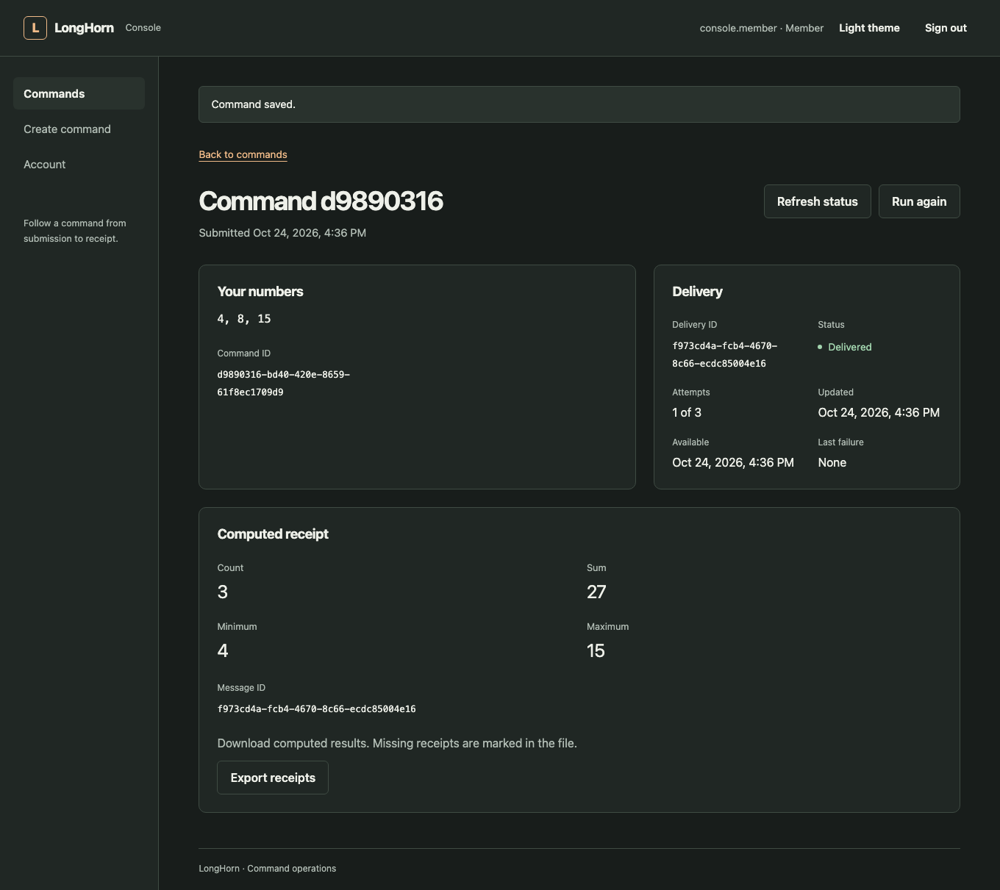

The [walkthrough](docs/command-application.md) explains how the parts connect.

<picture>
  <source media="(prefers-reduced-motion: reduce)" srcset="./docs/assets/divider-still.svg">
  
</picture>

## Modules

Core needs only `container`, `http`, `runtime` and `logger`. Everything else is imported
and wired by your application, so nothing starts behind your back.

| Package | What it gives you |
| --- | --- |
| [`@longhornjs/core`](docs/lifecycle.md) | The application: start, listen, drain, close |
| [`@longhornjs/container`](docs/dependency-injection.md) | Typed tokens and application singletons |
| [`@longhornjs/http`](docs/http.md) | A real Hono app with error defaults |
| [`@longhornjs/runtime`](docs/runtimes.md) | Fetch and listener contracts |
| [`@longhornjs/logger`](docs/logging.md) | Structured logs, redaction, request IDs |
| [`@longhornjs/validation`](docs/validation.md) | Standard Schema parsing and Hono input |
| [`@longhornjs/config`](docs/configuration.md) | Validated configuration |
| [`@longhornjs/database`](docs/database.md) | SQL, transactions and checksummed migrations |
| [`@longhornjs/auth`](docs/authentication.md) | Passwords, sessions and guards |
| [`@longhornjs/events`](docs/events.md) | Awaited in-process notifications |
| [`@longhornjs/cache`](docs/cache.md) | Memory or Redis, with shared loads |
| [`@longhornjs/queue`](docs/queues.md) | Persistent jobs, leases and retries |
| [`@longhornjs/scheduler`](docs/scheduler.md) | Durable one-time, interval and cron runs |
| [`@longhornjs/idempotency`](docs/idempotency.md) | Safe retries with saved replies |
| [`@longhornjs/ratelimit`](docs/request-limits.md) | Request budgets per subject |
| [`@longhornjs/outbox`](docs/outbox.md) | Transactional delivery, recovery and audit |
| [`@longhornjs/observability`](docs/observability.md) | Health, metrics, traces and OTLP export |

Optional [Rust computation](docs/rust-reports.md) sits behind a typed, authenticated
protocol.

<details>
<summary><b>More runnable examples</b>: jobs, Redis, D1, Durable Objects, telemetry and Rust</summary>

| Command | Runs |
| --- | --- |
| `pnpm dev` | Persistent tasks API on SQLite |
| `pnpm dev:auth` | Accounts, sessions and private notes |
| `pnpm dev:jobs` | Background reports with a durable queue and schedules |
| `pnpm demo:postgres` | Tasks and reports on a temporary PostgreSQL |
| `pnpm dev:d1` | Workers tasks on D1 with safe replay |
| `pnpm dev:durable-worker` | Reports stored in Durable Object SQLite |
| `pnpm dev:alarm-worker` | Reports driven by Durable Object alarms |
| `pnpm dev:queue-worker` | A Cloudflare Queues receipt app |
| `pnpm dev:outbox-worker` | Outbox delivery through a broker |
| `pnpm dev:redis-limits` | Redis request limits on a report API |
| `pnpm demo:tracing` | Traces to a real OpenTelemetry Collector |
| `pnpm demo:metrics` | Metrics to the Collector |
| `pnpm demo:logs` | Logs to the Collector |
| `pnpm demo:rust-reports` | Rust computing reports for the jobs app |

The [examples tour](docs/examples-tour.md) has ports, curl commands and settings for each.

</details>

<picture>
  <source media="(prefers-reduced-motion: reduce)" srcset="./docs/assets/divider-still.svg">
  
</picture>

## Find your way around the docs

There's one guide per feature, so you only read what you need.

| You want to | Read |
| --- | --- |
| Understand the whole system | [Project guide](docs/project-guide.md) |
| Follow one command through the code | [Command walkthrough](docs/command-application.md) |
| Run every example | [Examples tour](docs/examples-tour.md) |
| Pick a project template | [Starter templates](docs/starter-templates.md) |
| Look up one feature | [Feature index](docs/features.md) |
| See what runs on each host | [Runtime matrix](docs/supported-runtimes.md) |
| See how it's verified | [Release verification](docs/release-verification.md) |
| See where things stand today | [Development handoff](docs/development-handoff.md) |

<picture>
  <source media="(prefers-reduced-motion: reduce)" srcset="./docs/assets/divider-still.svg">
  
</picture>

## What is and isn't tested

<picture>
  <source media="(prefers-reduced-motion: reduce)" srcset="./docs/assets/gates-still.svg">
  
</picture>

| Run for real | Not claimed |
| --- | --- |
| 749 source tests, and 66 gates that start real engines, processes and browsers | A stable API: this is a first release, and it can still change |
| Processes killed with SIGKILL during and after commits | Anything on Windows: nothing has run there |
| Real PostgreSQL 18, Redis, D1, Durable Objects and OpenTelemetry Collector | Production or cloud deployment, failover or replication |
| Lost HTTP replies, concurrent writers and failed schema upgrades | Exactly-once delivery across systems |
| Generated projects, moved out of the repository and installed fresh | Password reset, account recovery or MFA |
| Backup, restore into empty storage, then a new command | Other browser engines, or VoiceOver and TalkBack on real devices |
| Console screens with axe in Chromium, in both themes and at phone width | Native PostgreSQL on anything other than Node |

Local checks ran on macOS ARM64, and all 10 CI jobs have passed on hosted Ubuntu 24.04,
which reaches all 66 gates. Nothing has run on Windows. The [runtime matrix](docs/supported-runtimes.md) has the
exact versions, and the [handoff](docs/development-handoff.md) has the current state.

<picture>
  <source media="(prefers-reduced-motion: reduce)" srcset="./docs/assets/divider-still.svg">
  
</picture>

## Where it's going

Feature development is paused while the project opens up. These come next:

| Next | Why it matters | Track it |
| --- | --- | --- |
| A real deployment guide | Every proof so far runs locally | [task006](tasks/task006-deployment-guide.md) |
| Account recovery | Auth has no password reset or recovery yet | [task008](tasks/task008-account-recovery.md) |

Run `pnpm task list` for the live board. The [handoff](docs/development-handoff.md) has the
current state.

<picture>
  <source media="(prefers-reduced-motion: reduce)" srcset="./docs/assets/divider-still.svg">
  
</picture>

## Contribute

The project is early, so your feedback can still change its direction. You don't need to
know the whole codebase. Most changes touch one package and one guide.

### Good ways to start

- **Try the quickstart and say where you got stuck.** A fresh pair of eyes is the
  thing this project has least of. [Start a discussion](https://github.com/MirHamzaHasan/longhorn/discussions).
- **Run it on your platform.** Checks have run on macOS ARM64 and hosted Ubuntu, and
  nothing has run on Windows. A report of what happened is useful, even if it just failed.
- **Fix a doc.** If a guide is wrong or confusing, a small pull request is welcome.
- **Pick up an open issue.** See
  [good first issues](https://github.com/MirHamzaHasan/longhorn/labels/good%20first%20issue)
  and [help wanted](https://github.com/MirHamzaHasan/longhorn/labels/help%20wanted).

Planning a new feature or a large change? Open an issue first, so nobody spends time on
something that doesn't fit.

### Set up

```sh
git clone https://github.com/MirHamzaHasan/longhorn.git
cd longhorn
pnpm install --frozen-lockfile
pnpm build       # required before typecheck and before scripts/verify-* gates
pnpm typecheck
pnpm test        # source tests; they need no build
```

Then run the narrowest check for what you changed:

| You changed | Run |
| --- | --- |
| One package | `pnpm vitest run packages/<name>` |
| A runtime adapter | `pnpm test:runtimes` |
| A SQL provider | `pnpm test:postgres` or `pnpm test:persistence` |
| The console | `pnpm test:console` |
| The CLI or a starter | `pnpm test:projects` |
| Outbox and delivery | `pnpm test:outbox` |

### How a change gets in

1. Fork the repository and branch from `main`.
2. Make the change and match the file you are in. There is no linter or formatter.
3. Update the feature's guide. Docs here say only what was really run.
4. Open a pull request, and say which checks you ran and on which platform.
5. CI runs and the maintainer reviews. It's fine to say you couldn't run a gate.

[CONTRIBUTING.md](CONTRIBUTING.md) has the details and the rules the code depends on.

### Working with coding agents

<picture>
  <source media="(prefers-reduced-motion: reduce)" srcset="./docs/assets/agents-still.svg">
  
</picture>

Coding agents are welcome, and you stay responsible for what you submit. Start them at
[AGENTS.md](AGENTS.md). Each agent claims one task from [tasks/](tasks/README.md) in its
own worktree, and a claim refuses files that another active task owns, so agents working
in parallel don't overwrite each other.

### Get help

| You want to | Go to |
| --- | --- |
| Ask a question or suggest an idea | [Discussions](https://github.com/MirHamzaHasan/longhorn/discussions) |
| Report a bug or request a feature | [Issues](https://github.com/MirHamzaHasan/longhorn/issues/new/choose) |
| Report a vulnerability, privately | [Security policy](SECURITY.md) |
| Read the community rules | [Code of conduct](CODE_OF_CONDUCT.md) |

<picture>
  <source media="(prefers-reduced-motion: reduce)" srcset="./docs/assets/divider-still.svg">
  
</picture>

## License

[MIT](LICENSE)
