<picture>
  <source media="(prefers-reduced-motion: reduce)" srcset="./docs/assets/hero-still.svg">
  
</picture>

<p>
  <a href="https://mirhamzahasan.github.io/longhorn/"><b>Website</b></a> &nbsp;|&nbsp;
  <a href="docs/project-guide.md"><b>Architecture</b></a> &nbsp;|&nbsp;
  <a href="docs/features.md"><b>All features</b></a> &nbsp;|&nbsp;
  <a href="docs/examples-tour.md"><b>Examples tour</b></a>
</p>


LongHorn is a modular TypeScript backend framework on [Hono](https://hono.dev) and Web
Standards. Your app runs on Node, Bun, Deno or Cloudflare Workers, using each
platform's own server. Add only the modules you use: database, auth, queues, schedules,
outbox delivery, rate limits, caching and observability.

> [!IMPORTANT]
> **Pre-release.** Nothing is on npm yet, so you run LongHorn from a checkout. It has
> been tested locally on macOS. It has not been deployed to production.
> See [what is and isn't tested](#what-is-and-isnt-tested).

## Start in a minute

You need Node 20.19 or newer and [pnpm](https://pnpm.io) 12.6.

<picture>
  <source media="(prefers-reduced-motion: reduce)" srcset="./docs/assets/quickstart-still.svg">
  
</picture>

```sh
git clone https://github.com/MirHamzaHasan/longhorn.git
cd longhorn
pnpm install
pnpm create:app ../my-api --runtime node
cd ../my-api
pnpm install
pnpm dev
```

```sh
curl http://127.0.0.1:3000/health
# {"status":"ok","runtime":"node","ready":true}
```

The new project is yours. It has its own copy of the framework, plus tests and guides,
and it works outside this repository.

### Choose a starting point

| You are building | Add to `pnpm create:app ../my-app` | Guide |
| --- | --- | --- |
| An HTTP API | `--runtime node`, `bun`, `deno` or `workers` | [Templates](docs/starter-templates.md) |
| An app with a database | `--runtime node`, `bun` or `deno`, then `--template sqlite-tasks` | [SQLite starter](docs/sqlite-starter.md) |
| An app with accounts | `--runtime node`, `bun` or `deno`, then `--template sqlite-auth` | [Auth starter](docs/auth-starter.md) |
| A Worker with storage | `--runtime workers --template d1-tasks` | [D1 starter](docs/d1-starter.md) |
| The complete console | `--runtime node --template command-app`, which needs PostgreSQL | [Command project](docs/command-project.md) |

## Your first app

```ts
import { Longhorn } from '@longhorn/core'
import { provide, token } from '@longhorn/container'
import { nodeRuntime } from '@longhorn/node'

const Greeting = token<{ say(name: string): string }>('greeting')
const app = new Longhorn()

app.container.register(provide(Greeting, {
  factory: () => ({ say: (name) => `Hello, ${name}` }),
}))

app.http.get('/hello/:name', (c) => {
  const greeting = c.get('container').resolve(Greeting)
  return c.json({ message: greeting.say(c.req.param('name')) })
})

const server = await app.listen(nodeRuntime, { port: 3000 })
console.log(server.url)
```

`app.http` is the real Hono app, so Hono routers and middleware work directly. To change
host, change the import and the last line:

| Host | Import | Start with | Storage |
| --- | --- | --- | --- |
| [Node](docs/runtimes.md) | `nodeRuntime` from `@longhorn/node` | `app.listen(nodeRuntime)` | SQLite, PostgreSQL, Redis |
| [Bun](docs/bun.md) | `bunRuntime` from `@longhorn/bun` | `app.listen(bunRuntime)` | Native `bun:sqlite` |
| [Deno](docs/deno.md) | `denoRuntime` from `@longhorn/deno` | `app.listen(denoRuntime)` | Built-in SQLite |
| [Workers](docs/workers.md) | `createWorker` from `@longhorn/workers` | `export default createWorker(app)` | D1, Durable Object SQLite |

Not every module runs everywhere. The [runtime matrix](docs/supported-runtimes.md) lists
exactly what was verified on each host.

## Work that survives failure

This is what LongHorn is built around. A command is saved together with its outgoing
message in one transaction, then delivered until it lands.

<picture>
  <source media="(prefers-reduced-motion: reduce)" srcset="./docs/assets/flow-still.svg">
  
</picture>

| What goes wrong | What happens | Tested in |
| --- | --- | --- |
| The receiver is down | The message stays saved and retries. If attempts run out, an operator can retry it, and that goes in an audit log | [Persistent operations](docs/persistent-operations-testing.md) |
| A delivery reply is lost | It sends again with the same message ID, and the receiver stores one result | [Outbox](docs/outbox-testing.md) |
| The process dies mid-commit | The transaction rolls back and leaves no partial writes | [Transactions](docs/transaction-publishing-testing.md) |
| The client never hears back | It retries with the same key and gets the original reply | [Idempotency](docs/idempotency-testing.md) |

Delivery is at-least-once with deduplication. It is not exactly-once across systems.

**See it run in the browser:**

```sh
pnpm install
pnpm demo:operator-accounts
```

Then open http://127.0.0.1:3010/console. Create an account and submit `4, 8, 15`. The
demo starts its own temporary PostgreSQL and removes it on Ctrl+C.


The [walkthrough](docs/command-application.md) explains how the parts connect.

## Modules

Core needs only `container`, `http`, `runtime` and `logger`. Everything else is imported
and wired by your application, so nothing starts behind your back.

| Package | What it gives you |
| --- | --- |
| [`@longhorn/core`](docs/lifecycle.md) | The application: start, listen, drain, close |
| [`@longhorn/container`](docs/dependency-injection.md) | Typed tokens and application singletons |
| [`@longhorn/http`](docs/http.md) | A real Hono app with error defaults |
| [`@longhorn/runtime`](docs/runtimes.md) | Fetch and listener contracts |
| [`@longhorn/logger`](docs/logging.md) | Structured logs, redaction, request IDs |
| [`@longhorn/validation`](docs/validation.md) | Standard Schema parsing and Hono input |
| [`@longhorn/config`](docs/configuration.md) | Validated configuration |
| [`@longhorn/database`](docs/database.md) | SQL, transactions and checksummed migrations |
| [`@longhorn/auth`](docs/authentication.md) | Passwords, sessions and guards |
| [`@longhorn/events`](docs/events.md) | Awaited in-process notifications |
| [`@longhorn/cache`](docs/cache.md) | Memory or Redis, with shared loads |
| [`@longhorn/queue`](docs/queues.md) | Persistent jobs, leases and retries |
| [`@longhorn/scheduler`](docs/scheduler.md) | Durable one-time, interval and cron runs |
| [`@longhorn/idempotency`](docs/idempotency.md) | Safe retries with saved replies |
| [`@longhorn/ratelimit`](docs/request-limits.md) | Request budgets per subject |
| [`@longhorn/outbox`](docs/outbox.md) | Transactional delivery, recovery and audit |
| [`@longhorn/observability`](docs/observability.md) | Health, metrics, traces and OTLP export |

Optional [Rust computation](docs/rust-reports.md) sits behind a typed, authenticated
protocol.

<details>
<summary><b>More runnable examples</b>: jobs, Redis, D1, Durable Objects, telemetry and Rust</summary>

| Command | Runs |
| --- | --- |
| `pnpm dev` | Persistent tasks API on SQLite |
| `pnpm dev:auth` | Accounts, sessions and private notes |
| `pnpm dev:jobs` | Background reports with a durable queue and schedules |
| `pnpm demo:postgres` | Tasks and reports on a temporary PostgreSQL |
| `pnpm dev:d1` | Workers tasks on D1 with safe replay |
| `pnpm dev:durable-worker` | Reports stored in Durable Object SQLite |
| `pnpm dev:alarm-worker` | Reports driven by Durable Object alarms |
| `pnpm dev:queue-worker` | A Cloudflare Queues receipt app |
| `pnpm dev:outbox-worker` | Outbox delivery through a broker |
| `pnpm dev:redis-limits` | Redis request limits on a report API |
| `pnpm demo:tracing` | Traces to a real OpenTelemetry Collector |
| `pnpm demo:metrics` | Metrics to the Collector |
| `pnpm demo:logs` | Logs to the Collector |
| `pnpm demo:rust-reports` | Rust computing reports for the jobs app |

The [examples tour](docs/examples-tour.md) has ports, curl commands and settings for each.

</details>

## What is and isn't tested

| Run for real | Not claimed |
| --- | --- |
| 749 source tests, and 66 gates that start real engines, processes and browsers | Published packages: nothing is on npm |
| Processes killed with SIGKILL during and after commits | A hosted CI pass on the latest code, because recent runs never started |
| Real PostgreSQL 18, Redis, D1, Durable Objects and OpenTelemetry Collector | Production or cloud deployment, failover or replication |
| Lost HTTP replies, concurrent writers and failed schema upgrades | Exactly-once delivery across systems |
| Generated projects, moved out of the repository and installed fresh | Password reset, account recovery or MFA |
| Backup, restore into empty storage, then a new command | Other browser engines, or VoiceOver and TalkBack on real devices |
| Console screens with axe in Chromium, in both themes and at phone width | Native PostgreSQL on anything other than Node |

Local checks ran on macOS ARM64. The [runtime matrix](docs/supported-runtimes.md) has the
exact versions, and the [handoff](docs/development-handoff.md) has the current state.

## Contributing

```sh
pnpm install --frozen-lockfile
pnpm build       # required before typecheck and before scripts/verify-* gates
pnpm typecheck
pnpm test
```

Each feature has its own guide that records its API, what connects to it, how it was
verified and what it doesn't do. Find them in the [feature index](docs/features.md).

Working with coding agents? Read [AGENTS.md](AGENTS.md). Each agent claims one task from
[tasks/](tasks/README.md) in its own worktree, so parallel work doesn't collide.

## License

[MIT](LICENSE)
