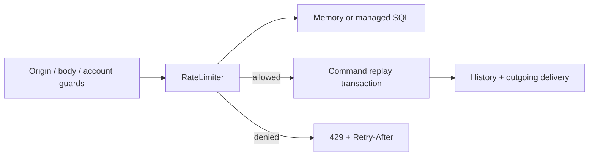

# Feature index and connections

This is the entrypoint for LongHorn's feature documentation. Every implemented
feature has its own guide. When changing a feature, update its guide, this index,
and the example that exercises it. Guides record ownership, APIs, upstream and
downstream connections, verification, and current limits.

## Live command history

See the [handoff](development-handoff.md) for verification and publication state. The
[architecture guide](project-guide.md) explains the whole system.

| Feature | Guide | Implementation owner | Connects to |
| --- | --- | --- | --- |
| Live history window | [List updates](command-history-updates.md) | Existing history GET and public metadata projection | Complete loaded windows, bounded keysets and atomic browser publication |
| History update ownership | [Read lifecycle](history-update-lifecycle.md) | Existing follow timer and page lifetime | Serial cycles, time/count/depth budgets, cancellation and manual paging |
| Live history controls | [Console updates](console-history-updates.md) | Existing native controls and keyed list | Focus/scroll, empty/filter states and preserved forms/exports |
| History update verification | [Native proof](history-update-testing.md) | Actual SQL/HTTP/broker/browser and independent apps | Public ownership, results, lifetimes, complete window and restored assets |

## Implemented baseline

The rows below describe implemented capabilities on `main`, not a published release.

| Feature | Guide | Implementation owner | Connects to |
| --- | --- | --- | --- |
| Active-session coordination | [Inventory API](session-inventory.md) | Optional @longhorn/auth/session-inventory | Captured hash-only input, fresh native authorization and public-only records |
| Session inventory continuation | [Cursors](session-inventory-cursors.md) | Service codec and SQL keyset | Expiry/reference order, bounded pages and owner/initiating-session binding |
| Native public session references | [Schema](session-inventory-schema.md) | Appended provider migrations | Unchanged legacy writers/history, backfill, native default/trigger and indexes |
| SQLite session inventory | [SQLite store](sqlite-session-inventory.md) | Managed SQLite provider subpath | Reauthentication, post-ownership clock, RETURNING projection and rollback |
| PostgreSQL session inventory | [PostgreSQL store](postgres-session-inventory.md) | Managed PostgreSQL provider subpath | Shared advisory/user/session ownership, READ COMMITTED and existing grants |
| Selected session HTTP controls | [HTTP routes](session-inventory-http.md) | Native auth examples and opt-in command accounts | Scoped pages, strict body/origin/viewer guards and current-cookie clearing |
| Session inventory lifetime | [Ownership](session-inventory-lifecycle.md) | Borrowed stores and HTTP/page owners | Commit acknowledgement, request/pool drain and mutation/navigation settlement |
| Account active sessions | [Console panel](console-session-inventory.md) | Existing Account page | Real expiry/current rows, manual pages, confirmation, focus and stale-view fencing |
| Native/browser session proof | [Verification](session-inventory-testing.md) | Native SQL/processes, Object SQLite and real browser | Upgrade/rollback, reciprocal revocation, SIGKILL, private API and accessible captures |
| Command budget maintenance modes | [Native tool](command-limit-maintenance.md) | Dedicated PostgreSQL process | Typed private files, read-only check, one bounded batch or owned periodic watch |
| Separate maintenance authority | [Role provisioning](command-limit-maintenance-role.md) | Transactional owner tool and read-only guard | Minimal bucket grants, rollback, schema/role/column checks and unchanged HTTP authority |
| Maintenance interruption | [Lifetime](command-limit-maintenance-lifecycle.md) | Managed app work and existing cleanup | Accepted SQL drain, idle stop, observer settlement and database last |
| Private maintenance report | [Report v1](command-limit-maintenance-report.md) | Standalone process | Aggregate counts, fixed warnings and signal/error exit status |
| Native/installed maintenance proof | [Verification](command-limit-maintenance-testing.md) | Native PostgreSQL, shipped archive and packed CLI | Real quota/replay preservation, negative authority, locks/signals, frozen install and actual commands |
| Owned bounded pruning | [Prune worker](prune-worker.md) | Optional @longhorn/runtime/prune-worker | Serial delayed batches, observer ownership and shared cleanup facades |
| Request budget cleanup | [Cleanup API](rate-limit-cleanup.md) | Optional @longhorn/ratelimit/cleanup | Existing limiter/store clocks and explicit native-host lifetime |
| Budget cleanup retention | [Expiry and authority](rate-limit-cleanup-retention.md) | Existing provider prune methods | Table-wide bounds, live preservation and separate PostgreSQL lock/delete grants |
| Budget cleanup shutdown | [Lifecycle](rate-limit-cleanup-lifecycle.md) | Shared worker and limiter admission | Reentrant close, actual native drain and reverse resource release |
| Maintained SQLite report API | [Example](rate-limit-cleanup-example.md) | examples/maintained-limits | Typed opt-in settings, capability identity, computed results and persisted quota |
| Native and packed cleanup proof | [Verification](rate-limit-cleanup-testing.md) | Native stores/hosts and independent package consumer | Locked drain, renewal/grants, retained budgets, frozen relocation and declarations |
| Object SQLite request budgets | [Existing managed store](object-request-limits.md) | SqliteRateLimitStore over createDurableSqlite | Native input gate, post-ownership clock, transaction rollback and persisted counters |
| Shared Object report budget | [Optional HTTP policy](object-report-limits.md) | Default-off scheduled/alarm report app | Both POST routes, typed bindings, DI, counted validation and unaffected background work |
| Object quota schema deployment | [Complete profiles](object-limit-deployment.md) | Report app migration composition | Unchanged scheduled/alarm history prefix, appended shared schema and retained toggles |
| Object quota drain and alarms | [Lifecycle](object-limit-lifecycle.md) | Existing limiter, Object SQL and clock hook | Accepted native work, borrowed binding, ambiguous commit and unchanged wakeup candidates |
| Native Object quota proof | [Verification](object-limit-testing.md) | Actual workerd and shipped Node owners | Forty-client contention, aborts, upgrades, automatic results, retention and disable/re-enable |
| Native SQLite batch request limits | [Batch store](batch-rate-limits.md) | Optional @longhorn/ratelimit/batch-sqlite | One UPSERT/RETURNING, database time, policy guard and bounded prune |
| D1 task creation attempt budget | [Public route](d1-request-limits.md) | Default-off example/starter capability | Shared public identity, validation/replay ordering and retained effects |
| D1 quota deployment | [Schema profile](d1-limit-schema.md) | Appended batch migration | Original checksum prefix, complete startup verification and private owner deployment |
| D1 quota lifetime | [Native drain](d1-limit-lifecycle.md) | Existing limiter and D1 handle | Accepted native work, lost acknowledgement and HTTP before database close |
| Native and installed D1 quota proof | [Verification](d1-limit-testing.md) | Actual workerd and packed CLI project | Batch/DDL rollback, race, two-worker budgets, expiry/replay and separate-host retention |
| Redis request attempt limits | [Redis store](redis-rate-limits.md) | Optional @longhorn/ratelimit/redis | Atomic server-clock reservations, fixed expiry and scoped hashes |
| Server-owned limiter time | [Clock contract](rate-limit-server-clock.md) | Explicit storage union and coordinator | Server observedAt, existing SQL callbacks and unchanged public decisions |
| Redis budget deployment | [Authority and durability](redis-rate-limit-deployment.md) | Dedicated trusted Redis and minimal ACL | Noeviction, native TTL, explicit persistence and stable labels |
| Redis limiter lifetime | [Borrowed connection](redis-rate-limit-lifecycle.md) | Existing Node connection and limiter drain | Ambiguous commitment, no retries, real deadline and retained windows |
| Protected Redis limit example | [Report API](redis-rate-limit-example.md) | examples/redis-limits | Typed config, bearer mapping, shared hosts, calculation and readiness |
| Native Redis budget proof | [Verification](redis-rate-limit-testing.md) | Redis server, real TCP/HTTP and finite runtimes | Eighty-way contention, ACL denial, SIGKILL/AOF and lost-reply shutdown |
| Portable request attempt limits | [Limiter](request-limits.md) | @longhorn/ratelimit | Scoped hashed identity, fixed windows, policy mismatch and explicit drain |
| Bounded memory request limits | [Memory store](rate-limit-memory.md) | Map and indexed expiry heap | Capacity fail-closed, live bucket preservation and bounded pruning |
| Managed SQL request limits | [SQL stores](rate-limit-sql.md) | SQLite/PostgreSQL provider subpaths | Post-ownership clock, committed counters, owner migrations and separate maintenance |
| Request limit HTTP adapter | [Hono middleware](rate-limit-http.md) | Explicit trusted identity resolver | 429 Retry-After, private 503 and awaited error observer |
| Request limiter lifetime | [Owned drain](rate-limit-lifecycle.md) | Core admission and optional DI provider | Accepted hashing/native work before borrowed database close |
| Account command attempt budget | [Command wiring](command-request-limits.md) | Default-off operations capability | Shared sessions/hosts, guards, readiness/preflight and retained backups |
| Native request limit proof | [Verification](rate-limit-testing.md) | Actual runtimes, SQL, HTTP and archived apps | Contention, migration races, SIGKILL, no blocked effects and restore |
| Operator runtime preflight | [Preflight](operator-preflight.md) | App-local coordinator and native check entry | Shared config/readiness, assets, restricted role, receiver and close |
| Versioned diagnostic observations | [Report v1](operator-preflight-report.md) | Fixed IDs/statuses/hints | Private values omitted, dependency skips and explicit interrupted state |
| Shared PostgreSQL readiness | [Schema checks](postgres-application-readiness.md) | Startup, live readiness and preflight | One runtime-visible probe helper and existing optional capabilities |
| Diagnostic lifetime | [Probe ownership](operator-preflight-lifecycle.md) | Exclusive pool factory and CLI script owner | Admitted work/close drain, signal propagation and custom pnpm fallback |
| Native preflight proof | [Preflight verification](operator-preflight-testing.md) | Actual archive/installed CLI, PostgreSQL and HTTP peers | Failure/recovery, pending/expired rows untouched, native SQL interruption and no listener |
| Command source development | [App source loop](command-source-development.md) | Generated dev.mjs and shared build settings | Recursive server/console source, private profiles and usable paired generations |
| Development build admission | [Build coordination](command-development-builds.md) | One owned revision/debounce/build sequence | In-memory output, superseded work, old native exit and per-role output |
| Development native lifetime | [Process drain](command-development-lifecycle.md) | Fixed CLI dev owner and isolated Node child | Actual close, awaited builds, failed/forced stop and generic script fallback |
| Receiver source development | [Receiver watch](receiver-source-development.md) | Separate role and Miniflare resource owner | Protected source reload, retained receipt storage and independent app output |
| Native development proof | [Watch verification](command-development-testing.md) | Installed CLI, real SQL/HTTP and retained workerd | Compile/recovery, recursive modules, active request drain, latest edits and forced-stop failure |
| Complete command CLI profile | [Command project](command-project.md) | Existing CLI createProject and shared archive recipe | Node/PostgreSQL console, explicit receiver, editable source and setup |
| Command template snapshot | [Checked source](command-project-snapshot.md) | CLI snapshot builder and shared descriptor reader | Actual app/tests/guides, selected local graph and atomic publication |
| Command CLI host ownership | [Script lifetime](command-project-lifecycle.md) | Fixed start script and native host | One owner signal, custom/hook pnpm fallback and actual exit |
| Packed command project proof | [Installed verification](command-project-testing.md) | Relocated installed CLI and shared archive workflow | Both creation binaries, real SQL/browser/restore, fixed/custom start and retained installs |
| Owned replay cleanup | [Cleanup worker](idempotency-cleanup.md) | Optional @longhorn/idempotency/cleanup | Existing prune/clock, serial bounded batches and private aggregate snapshot |
| Cleanup shutdown | [Cleanup lifetime](idempotency-cleanup-lifecycle.md) | Application startup resources | One owner, awaited errors, no catch-up and SQL drain before database close |
| Replay expiry and removal | [Retention](request-cleanup-retention.md) | Existing SQL IdempotencyStore | Table-wide expired rows, active ownership, preserved business records and key reuse |
| Operator request cleanup | [Host wiring](request-cleanup-host.md) | Typed runtime config and operations DI | Default-off flags, existing SELECT/DELETE grants and readiness |
| Native cleanup proof | [Cleanup testing](request-cleanup-testing.md) | Actual native runtimes/SQL and restored archive | Real SQLite deletion, restricted PostgreSQL, grant recovery, held replacement and pool ordering |
| Authenticated session controls | [Session controls](session-controls.md) | AuthService optional capability | Reauthenticated others/all scopes, live counts, current/peer preservation and explicit opt-in |
| Native SQLite session controls | [SQLite session controls](sqlite-session-controls.md) | Optional auth/sqlite-session-controls | Existing schema, managed ownership, post-wait expiry and atomic scoped deletion |
| Restricted PostgreSQL session controls | [PostgreSQL session controls](postgres-session-controls.md) | Optional auth/postgres-session-controls | Existing transaction-auth grants, shared protocol admission, row ownership and READ COMMITTED |
| Guarded session-control HTTP | [Session HTTP](session-controls-http.md) | Native auth and optional PostgreSQL routing | Exact-origin cookies, strict scope, guarded legacy logout-all and private results |
| Native session-control proof | [Session testing](session-controls-testing.md) | Real runtimes/SQL and copied projects | Reciprocal races, login/password ordering, wait expiry, native rollback and four SIGKILL checkpoints |
| Authenticated password replacement | [Password changes](password-changes.md) | AuthService opt-in capability | Current password, fixed input policy, durable reauthentication budget and atomic session revocation |
| Credential-fenced session issuance | [Session fencing](password-session-fencing.md) | SessionManager.createIf and SQL store ports | Private candidates, expected-hash commit, current login-only hosts and old-verifier rejection |
| Native SQLite credential mutation | [SQLite passwords](sqlite-password-changes.md) | Optional auth/sqlite-passwords | Existing schema, managed transaction, post-ownership expiry and copied inputs |
| Restricted PostgreSQL credential mutation | [PostgreSQL passwords](postgres-password-changes.md) | Optional auth/postgres-passwords | Shared/exclusive advisory protocol, two owner-deployed functions, explicit grants and original history |
| Guarded password HTTP | [Password HTTP](password-change-http.md) | Native auth/optional PostgreSQL routes | Exact origin/cookie, strict reauthentication JSON, 204 clear and preserved peers/notes |
| Password change native proof | [Password testing](password-change-testing.md) | Actual SQL/runtimes and generated projects | Stale-login/replacement races, trigger rollback, SIGKILL before commit, active KDF drain and retained HTTP |
| CLI forwarding to owned scripts | [Script owners](cli-owned-scripts.md) | CLI execute and fixed auth dev/start scripts | One parent signal, native drain, generic fallback and POSIX terminal-group proof |
| Independent native auth projects | [Auth starter](auth-starter.md) | CLI sqlite-auth profile | Selected Node/Bun/Deno, real editable app, native crypto/SQLite and connected guides |
| Checked auth source/test snapshot | [Auth assets](auth-starter-snapshot.md) | CLI snapshot builder and descriptor v1 | Exact shared source, checked native test mapping, selected package closure and independent archives |
| Configured auth native launching | [Auth launcher](auth-starter-launcher.md) | Generated Node host owner | Shared config schema, environment precedence, literal Deno grants and actual-exit cleanup |
| Owned auth source development | [Auth development](auth-starter-development.md) | Generated esbuild watcher | Compile-error retention, serial native drain, current configuration and retained sessions |
| Packed native auth workflow proof | [Auth project testing](auth-starter-testing.md) | Installed CLI and native hosts | Frozen relocation, source/persistence cases, raw crypto, 1006-note pages, grants, reload and schema recovery |
| Shared fixed scrypt policy | [Password policy](scrypt-password-policy.md) | Optional @longhorn/auth/scrypt | Existing Node wire format, trusted native drivers, dummy work and actual-settlement admission |
| Native Bun password hashing | [Bun passwords](bun-passwords.md) | Optional @longhorn/bun/passwords | Native async crypto, shared policy and PasswordHasher contract |
| Native Deno password hashing | [Deno passwords](deno-passwords.md) | Optional @longhorn/deno/passwords | Native async crypto, shared policy and legacy/peer hashes |
| Three native authentication hosts | [Native auth example](native-auth-example.md) | Existing auth app and explicit runtime hosts | Shared retained SQLite, credentials/sessions, cookie/role boundaries and drained native work |
| Bounded private-note pages | [Note pages](auth-note-pages.md) | Shared auth example query/helper | Strict owner/cursor/limit SQL, original index, exact int64 IDs and live pagination |
| Native password/auth proof | [Native auth testing](native-password-testing.md) | Actual Node/Bun/Deno processes | Independent raw crypto vectors, native signal drain, mixed sessions and large owner pages |
| Independent Deno SQLite app | [Deno SQLite project](deno-sqlite-starter.md) | Existing CLI public SQLite profile | Native editable tasks, selected framework graph, relocation and retained development |
| Checked Deno source/test distribution | [Deno source snapshot](deno-sqlite-starter-snapshot.md) | CLI builder and descriptor v1 | Actual app/tests, checked imports/port mapping, native case adapter and trusted assets |
| Configured Deno project permissions | [Deno launcher policy](deno-sqlite-starter-permissions.md) | Project Node launcher and named grants | Shared schema, environment precedence, literal data paths, native denial and policy-file cleanup |
| Owned Deno source development | [Deno replacements](deno-sqlite-starter-development.md) | Node/esbuild watcher and pinned Deno | Compile-failure retention, serial host drain, current config and failure reporting |
| Packed Deno SQLite workflow proof | [Deno project verification](deno-sqlite-starter-testing.md) | Installed/relocated CLI gate | Frozen install, 47 native cases, persistence, grant denial, restart/watch/schema recovery |
| Native Deno SQLite | [Deno storage](deno-sqlite.md) | Optional @longhorn/deno/sqlite | Native built-in driver, exact values/metadata, admission budgets and actual close |
| Deno SQLite binding slots | [Binding plan](deno-sqlite-bindings.md) | Adapter-local SQL/slot scan | Exact arity, names/numbered holes, input snapshots and unchanged result column names |
| Deno callback transaction ownership | [Deno transactions](deno-sqlite-transactions.md) | Canonical file gate and managed executors | Async callback lifetime, native rollback fencing and existing queue/scheduler/replay stores |
| Persistent Deno tasks | [Deno task host](deno-sqlite-tasks.md) | Same shared task app/repository | Scoped runtime permissions, checked schema, pages/counts, local observations and retained restart |
| Native Deno storage proof | [Deno SQL testing](deno-sqlite-testing.md) | Real Deno processes and Node/Bun peers | Permission denial, crash/lock behavior, 1029-task pages and retained int64 interoperability |
| Owned Node executable | [Managed process](managed-node-process.md) | Optional @longhorn/node/process | Absolute trusted executable, bounded output/startup, cancellation, actual exit and forced-stop failure |
| Async report computation acquisition | [Report resources](report-computer-resources.md) | Jobs resource factory and ReportCompute DI | Startup rollback, dependency readiness and queue-before-computation/storage drain |
| Lifecycle-owned Rust service | [Owned native reports](owned-native-reports.md) | Node jobs application resource | Minimal child environment, random credential, versioned health, client-before-child release |
| Persistent native jobs workflow | [Native jobs host](native-jobs-host.md) | Explicit Node host and launcher | Locked build, retained SQLite, early parent signals, bind rollback and failed-child recovery |
| Actual managed-process proof | [Owned process testing](managed-process-testing.md) | Real Node fixtures and locked Rust gate | Split frames/output limits, force failure, retained host restart and startup cancellation |
| Optional Rust compute service | [Native reports](rust-reports.md) | Native Cargo workspace | Authenticated pure report protocol, bounded handler ownership and graceful signals |
| Portable typed native client | [Report client](native-report-client.md) | Jobs application module over shared JSON client | Input snapshots, protocol/result validation, four-runtime Fetch and real call drain |
| Native report job backend | [Jobs/Rust](jobs-native-reports.md) | ReportCompute DI and existing queue | Explicit configuration, readiness, cancellation, retry/recovery and retained SQLite results |
| One-command native workflow | [Rust demo](rust-reports-demo.md) | Owned native/jobs processes | Random service credentials, actual computed report and ordered temporary cleanup |
| Native Rust interoperability gate | [Rust proof](rust-reports-testing.md) | Locked build and actual processes | Admission/body timeout, Node/Bun/Deno/workerd, outage/restart, demo and launcher |
| Bounded Node/Bun task reads | [SQLite task pages](sqlite-task-pages.md) | Shared task schema/service/repository | Typed cursor/filter pages, exact int64 boundaries and bounded SQL lookahead |
| Whole-collection SQL summaries | [Task counts](sqlite-task-counts.md) | TasksStore.counts and existing cache | One-row aggregates, safe counts, unchanged TTL/invalidation/fallback and Redis profile |
| Retained read/index upgrade | [Task read proof](sqlite-task-read-upgrades.md) | Task manifest and native/installed gates | Unchanged original checksum, appended filtered index and 1029-task HTTP traversal |
| Independent Bun SQLite project | [Bun starter](bun-sqlite-starter.md) | CLI runtime/profile selection | Existing public SQLite template, native source/tests and selected package closure |
| Drained Bun development reloads | [Bun development](bun-sqlite-starter-development.md) | Generated Node/esbuild supervisor | Failed-compile retention, serial native replacement and owned signal cleanup |
| Installed Bun project gate | [Bun project proof](bun-sqlite-starter-testing.md) | Packed CLI and actual Bun hosts | Relocation/frozen install, source/native tests, env/watch/schema failure and retained restart |
| Native Bun SQLite connection | [Bun storage](bun-sqlite.md) | `@longhorn/bun/sqlite` | Exact int64/blob values, bounded admission, native metadata and drained close |
| Async Bun transaction ownership | [Bun transactions](bun-sqlite-transactions.md) | Native BEGIN/COMMIT and managed scope | Canonical file gates, auto-rollback fencing and joined queue publishers |
| Shared SQLite statement boundary | [Statement scanner](sqlite-statement-boundary.md) | Optional shared database entrypoint | D1 compatibility, Bun prefix rejection and trigger bodies |
| Persistent Bun task host | [Bun tasks](bun-sqlite-tasks.md) | `examples/bun-sqlite` | Existing task service/repository, DI, migrations, cache/events and native listener |
| Native Bun storage gate | [Bun proof](bun-sqlite-testing.md) | Actual Bun files/processes and HTTP | SQL stores, lock contention, process kills, concurrent writes and retained restart |
| Persistent Node SQLite project | [SQLite starter](sqlite-starter.md) | CLI SQLite profile | Editable task service, native file persistence, typed events and derived memory cache |
| Shared application asset reader | [Template assets](application-template-assets.md) | CLI asset/profile modules | Compatible D1/Node descriptors, checked hashes/paths/bytes and selected package closures |
| SQLite starter resource lifetime | [SQLite lifetime](sqlite-starter-lifecycle.md) | Source/compiled Node host | Environment precedence, project data paths, startup/schema checks, source watching and drain |
| Independent SQLite project gate | [SQLite project proof](sqlite-starter-testing.md) | Packed binaries and native installed hosts | Automatic/frozen install, concurrent writers, integrity, environment/watch/schema failure and D1 regression |
| Persistent D1 project template | [D1 starter](d1-starter.md) | CLI profile selection | Explicit Workers template, editable app, local D1 and existing script delegation |
| D1 source/asset distribution | [D1 snapshot](d1-starter-snapshot.md) | CLI build and asset reader | Actual example source, dependency closure, hashes, relative files and packed binaries |
| Owned D1 development reloads | [D1 development](d1-starter-development.md) | Generated watcher and local host | Browser builds, failed-compile retention, serialized process replacement and signals |
| Independent D1 starter gate | [D1 project proof](d1-starter-testing.md) | Packed/installed CLI and generated app | Relocation, frozen install, shipped native tests, actual host/watch/failure/restart |
| Predeclared batch request replay | [Batch idempotency](batch-idempotency.md) | `@longhorn/idempotency/batch-sqlite` | Atomic result/business plans, JSON snapshots and positive commit recovery |
| Batch replay ownership and cleanup | [Batch records](batch-idempotency-storage.md) | Separate SQLite request ledger | Unique generations, admission-time expiry, rollback restoration and bounded pruning |
| Replayable D1 task creation | [D1 request HTTP](d1-idempotency-http.md) | TaskRequests DI and POST /tasks | Optional key, original 201/body/Location, normalized conflicts and atomic activity |
| Retained D1 request-ledger upgrade | [D1 upgrade](d1-idempotency-upgrades.md) | Complete manifest and private helper | Unchanged legacy checksums, appended ledger and read-only startup recovery |
| Native D1 replay verification | [D1 replay proof](d1-idempotency-testing.md) | Real D1/workerd and owned HTTP gateway | Lost committed reply, races, expiry replacement, pruning and retained restart |
| Atomic batch database capability | [Batch database](batch-database.md) | `@longhorn/database` | Ordered predeclared SQL, native atomicity, separate from callback transactions |
| Guarded batch schema history | [Batch migrations](batch-migrations.md) | `@longhorn/database/batch` | Immutable checksums, prefix fencing, whole-suffix commit and read-only verification |
| Native Workers D1 provider | [D1 storage](workers-d1.md) | `@longhorn/workers/d1` | Binding/session borrowing, SQL/scalar boundaries, bounded admission and actual drain |
| D1 deployment/startup ownership | [D1 deployment](d1-deployment.md) | Trusted schema worker and local host | Retained storage, private schema invocation, read-only application startup and config |
| Persistent revision-checked D1 tasks | [D1 tasks](d1-tasks.md) | `examples/d1-worker` | Hono validation, DI/lifecycle, conditional SQL edits and atomic activity |
| Atomic retained D1 task activity | [D1 activity](d1-task-activity.md) | D1 task repository/schema | Mutation tokens, stale-write exclusion, rollback and history after deletion |
| Exact D1 keyset cursors | [D1 pages](d1-pagination.md) | Task/activity queries and page schema | int64 decimal strings, CAST text, bounded SQL lookahead and cross-worker reads |
| Native D1 verification | [D1 testing](d1-testing.md) | Actual D1/workerd and owned hosts | Rollback, upgrade races, revision conflicts, wide cursors, retained restart and signals |
| Explicit synchronous sink fanout | [Log sinks](logger-sinks.md) | `@longhorn/logger` | Existing normalization/console routing, ordered destinations and exception isolation |
| Buffered async log delivery | [Log processing](log-processing.md) | `@longhorn/observability` | Synchronous sink, count/byte admission including active work, serial export and final drain |
| Remote log transport | [OTLP logs](otlp-logs.md) | `@longhorn/observability/otlp-logs` | Shared Fetch delivery, log-specific acknowledgements, bounded batches and sanitized errors |
| Log record wire mapping | [Log JSON](otlp-logs-json.md) | Entry snapshot / exporter encoder | Event/observed clocks, severity, nested AnyValue and explicit trace context |
| Report remote logs and demo | [Jobs logs](jobs-logs-export.md) | Jobs logger/config/lifecycle | Local output, remote metadata projection, correlation, diagnostics and close after producers |
| Native log interoperability | [Log proof](otlp-logs-testing.md) | Real collector / gateway / four runtimes | Normalized fields, cancellation, ambiguous acknowledgement, overload, actual report outage/recovery |
| Lifecycle-owned metric reader | [Metric reader](metric-reader.md) | `@longhorn/observability` | Timed cumulative collection, serial point batches, coalesced flush and final drain |
| Remote metric transport | [OTLP metrics](otlp-metrics.md) | `@longhorn/observability/otlp-metrics` | Shared bounded Fetch delivery, metric-specific acknowledgements and secret-safe counters |
| Cumulative metric record mapping | [Metric JSON](otlp-metrics-json.md) | Internal exporter encoder | Registry time identity, monotonic sums, signed gauges and disjoint histogram buckets |
| Report metric push and demo | [Jobs metrics](jobs-metrics-export.md) | Jobs diagnostics and owned demo | Independent host configuration, refreshed gauges, source totals through outage and shutdown |
| Native metric interoperability | [Metric proof](otlp-metrics-testing.md) | Real collector, gateway and four runtime fixtures | Actual normalized points, retries, HTTP peer cancellation, persisted report work and final export |
| Redis cache provider | [Redis storage](redis-cache.md) | `@longhorn/cache/redis` | Existing typed cache, namespace isolation, server expiry, bounded SCAN clear and owned client |
| Schema-validated cache JSON | [Cache JSON codec](cache-json-codec.md) | `@longhorn/cache/json` | Versioned undefined/value envelope, asynchronous application validation, byte/depth bounds |
| Native Redis connection | [Node Redis](redis-node.md) | `@longhorn/node/redis` | Explicit TLS trust, bounded native deadlines/admission, no replay/reconnect and drained close |
| Shared task-summary cache profile | [Redis tasks](redis-tasks-example.md) | Basic task example | DI-selected store, SQLite authority, invalidation and explicit failure bypass |
| Redis native verification | [Redis testing](redis-cache-testing.md) | Owned server/proxy/HTTP fixtures | Real expiry, ACL, restart, withheld acknowledgement, TLS, outage and startup cleanup |
| Hosted review artifact reporting | [CI artifacts](ci-review-artifacts.md) | Browser/distribution workflow jobs | Separate verification/upload outcomes, quota warning, local fallback, bounded retention when available |
| Locked application dependency graph | [Locked dependencies](command-app-dependencies.md) | Packager and shipped pnpm lock | Per-artifact resolution, CI-mode frozen install, manifest drift rejection |
| Independent command application archive | [Distribution](command-app-distribution.md) | Packaging script and editable starter | Source, receiver, framework snapshot, fresh installation |
| Persistent application deployment profile | [Deployment](command-app-deployment.md) | Starter scripts and host | Separate owner/runtime credentials, ingress/storage settings |
| Trusted runtime grant tool | [Runtime grants](runtime-role-grants.md) | PostgreSQL deployment function | Exact transactionally added grants, invalid/admin role denial |
| Independent application native gate | [Archive verification](command-app-testing.md) | Relocated archive and owned native services | Build/install, real browser/results, recovery, restore and privileges |
| Coordinated offline state checkpoint | [Backup and restore](command-app-backup.md) | Starter maintenance tool | PostgreSQL archive, stopped receiver files, checksums and ACL repair |
| Application schema/config upgrades | [Upgrade procedure](command-app-upgrades.md) | Deployment process | Retained artifact, maintenance checkpoint, immutable history and smoke checks |
| Repeatable CI configuration | [Release verification](release-verification.md) | GitHub workflow | Source/types, native operations, Chromium and independent restore |
| Verified deployment/runtime scope | [Support matrix](supported-runtimes.md) | Runtime and native evidence | Explicit versions, provider boundaries and revision-specific hosted availability |
| Reuse saved command numbers | [Run again](command-rerun.md) | Existing detail/review form and protected APIs | Admitted source, explicit review, fresh request key, separate command/delivery and preserved original |
| Displayed-account consistency | [Viewer binding](console-viewer-binding.md) | Optional PostgreSQL account middleware and console helper | Cookie-derived principal matching, stale-view 401, no handler effects and preserved other cookie |
| Native command reuse proof | [Reuse testing](command-rerun-testing.md) | Actual Chromium/PostgreSQL/broker and restored app | Real receipts, edited/manual replay, scope, legacy data, navigation, account switch and 117 captures |
| Command detail updates | [Live updates](command-live-updates.md) | Existing protected detail and receipt GETs | Real receipt arrival, terminal stop, one cycle at a time and bounded explicit restarts |
| Page-owned update lifetime | [Follow lifetime](command-follow-lifecycle.md) | Console controller and API cancellation | Hidden/offline pause, fixed deadline, generation fences and navigation disposal |
| Browser follow controls | [Receipt following](console-command-follow.md) | Existing detail screen and kit | Pause/resume, polite state messages, stable keyboard focus and manual refresh |
| Native command follow proof | [Follow testing](command-follow-testing.md) | Native SQL/broker, Chromium and independent archive | Real receipt without refresh, cancellation/auth boundaries, budgets and 26 accessible captures |
| Working web console | [Console](web-console.md) | PostgreSQL example browser client | Signup, history, commands, receipts and real API failures |
| Console browser boundary | [Console security](console-security.md) | Fixed asset routes and client API helper | CSP, HttpOnly cookies, relative requests, session clearing |
| Browser account settings | [Account](console-account.md) | Console Account route and host capability | Password confirmation, current-session probe, pending navigation, secret clearing and sign-in after replacement |
| Browser sign-in controls | [Console session controls](console-session-controls.md) | Existing Account route and shared mutation state | End others/all, count feedback, cross-action exclusion, late results and no ambiguous replay |
| Browser account native proof | [Account testing](console-account-testing.md) | Chromium and native PostgreSQL/scrypt | Live 401 distinction, peer revocation, throttling, lost/late responses and 58 captures |
| Browser operator recovery | [Console recovery](console-recovery.md) | Console delivery/audit screens | Current allowance, deliberate retry, conflict and account attribution |
| Console interaction design | [Design rules](console-design.md) | Browser CSS and DOM | Light/dark tokens, responsive hierarchy, honest states |
| Native browser verification | [Console testing](console-testing.md) | Chromium, axe and owned native services | Actual receipts, dropped responses, keyboard and 117 command/recovery/reuse/filter captures |
| Complete command application | [Walkthrough](command-application.md) | Existing demo and persistent host | End-to-end accounts, DI, transactions, delivery and recovery |
| Selected command history export | [Export](history-export.md) | Existing authenticated history pages and browser collector | Full selection across explicit bounded continuation files, metadata only |
| Versioned history export file | [Export format](history-export-format.md) | Portable NDJSON serializer | Header/records/summary, safe projection, UTF-8 bounds and exact continuation |
| Export lifetime and admission | [Export ownership](history-export-lifecycle.md) | Page cleanup, AbortSignal and fresh GET authorization | Cancel/timeout discard, scope/viewer checks and temporary Blob cleanup |
| Browser export controls | [Export UI](console-history-export.md) | Existing Commands route and kit | Export/cancel/continue/start over, real counts and stable focus |
| Native export proof | [Export testing](history-export-testing.md) | Native PostgreSQL, actual downloads and restored archive | 10000-row segment plus exact continuation, private-field exclusion and 34 captures |
| Bookmarkable history selection | [View links](history-view-links.md) | Strict pure Web route codec | Canonical scope/status fragments, legacy routes and rejected unknown claims |
| Browser history navigation | [View navigation](console-history-navigation.md) | Commands selectors and render lifetime | Reload, Back/Forward, contextual return links and fresh first pages |
| Validated sign-in destination | [View sign-in](history-view-sign-in.md) | Existing credential forms and 401 handling | Cold/expired/registration return, enum-only target and fresh owner/operator admission |
| Native saved-view proof | [View testing](history-view-link-testing.md) | Native accounts, Chromium and restored archive | Private-free links, role denial, canceled paging, selection export and 26 captures |
| Command-ID prefix search | [ID search](history-id-search.md) | PostgreSQL history query/repository | Case-folded UUID prefix, parameterized predicates and unchanged owner/role policy |
| Search-bound continuation | [Search cursors](history-search-cursors.md) | Strict v3 cursor codec | Exact q/state/viewer context, int64 positions and original v1/v2 compatibility |
| Search expression index deployment | [Search migrations](history-search-migrations.md) | Appended owner profile/readiness | Global/owner lower-ID pattern indexes, atomic ledger/DDL and existing grants |
| Browser ID search | [Search controls](console-history-search.md) | Native form, saved view router and paging | Explicit submit/clear, inline errors, query-aware links/cancellation and status composition |
| Searched export format | [Search files](history-search-export.md) | Existing bounded metadata collector | v2 q selection, original v1 files, exact search continuation and no secret fields |
| Native ID search proof | [Search testing](history-search-testing.md) | Real PostgreSQL, Chromium and restored archive | Upgrade interruption, live queue states, 6000-row plans, query context and 26 captures |
| Account command history | [History API](account-command-history.md) | PostgreSQL operations router/repository | Accounts, DI, owner filters, existing command detail |
| Delivery status history filters | [History filters](history-status-filters.md) | PostgreSQL history repository and account query | Live pending/running/succeeded/failed/unavailable membership, same owner/operator admission |
| Filter-bound continuation | [Filter cursors](history-filter-cursors.md) | Versioned strict cursor codec | Original v1 unfiltered links, exact-status v2, copied inputs and decimal int64 positions |
| History filter index deployment | [Filter migration](history-filter-migrations.md) | Appended owner migration and readiness | Two partial indexes, transactional rollback, valid/ready table checks and existing grants |
| Browser history selection | [Console filters](console-history-filters.md) | Existing console kit and Commands route | Native labelled selects, fresh pages, scope retention, canceled continuation isolation |
| Native history filter proof | [Filter testing](history-filter-testing.md) | Native PostgreSQL, Chromium and restored app | Real leases/states, index plans, rollback, cursor context, cancellation and retained archive |
| Command history schema upgrade | [History migrations](command-history-migrations.md) | Complete operations migration profile | Retained business rows, safe legacy association, int64 indexes |
| Context-bound history pagination | [History cursors](command-history-cursors.md) | History codec/query | Principal/scope/queue context, exact int64 seek, live traversal |
| Live command delivery projection | [Delivery metadata](command-history-delivery.md) | Explicit SQL projection | Outbox status, independent retention, no payload/lease reads |
| Native history gate | [History verification](command-history-testing.md) | Process and HTTP fixtures | Upgrade interruption, concurrent writers, restart and minimal grants |
| Bounded service JSON client | [JSON client](service-json-client.md) | `@longhorn/http/client` | Explicit credentials, deadlines/bytes, cancellation ownership, Fetch runtimes |
| Bearer service capability | [Bearer capabilities](bearer-capabilities.md) | `@longhorn/auth/bearer` | Native MAC verification, service policy, receiver and operations |
| HTTP Outbox publisher | [HTTP publisher](outbox-http-publisher.md) | `@longhorn/outbox/http` | Strict acceptance, stable IDs, existing dispatcher/retries |
| Conflicting receipt protection | [Receipt conflicts](receipt-deduplication-conflicts.md) | ReceiptStore Object | Transactional dedupe, broker/HTTP effects, retained schema |
| Durable HTTP receiver | [HTTP receiver](http-message-receiver.md) | Worker receiver and local host | Protected endpoints, Object SQL, retained disk storage |
| Persistent operator configuration | [Host configuration](operator-host-configuration.md) | PostgreSQL operator profile | Runtime role checks, explicit remote settings, private env files |
| Remote receipt and health integration | [Receipt transport](operator-receipt-transport.md) | PostgreSQL operation transport | Ownership guards, strict response schema, readiness signals |
| Persistent account operations executable | [Persistent host](persistent-operator-host.md) | PostgreSQL operator host | Existing DI/lifecycle/accounts, dispatcher, restart recovery |
| Persistent host native gate | [Persistent verification](persistent-operations-testing.md) | Process and runtime fixtures | Actual TCP/SQL, remote commit/SIGKILL, persisted user audit |
| Transactional account authorization | [Transaction authentication](transaction-authentication.md) | `@longhorn/auth` | Managed SQL scope, current sessions/roles, protected mutations |
| PostgreSQL principal locking | [Transaction auth function](postgres-transaction-auth.md) | `@longhorn/auth/postgres` | Opt-in migration, restricted runtime, native row locks |
| Authorized recovery transaction | [Authorized retry](outbox-authorized-retry.md) | `@longhorn/outbox` | Auth callback, conditional retry, audit, Object alarms |
| Shared operations router | [Outbox Hono](outbox-hono.md) | `@longhorn/outbox/hono` | App admission policy, strict schemas, queue-bound pages |
| Account commands and recovery | [Account operations](account-operations.md) | `examples/postgres` | DI, cookies, scoped idempotency, outgoing messages, receipts |
| Trusted role administration | [Operator provisioning](operator-provisioning.md) | Auth stores and PostgreSQL CLI | Role/session atomicity, dedicated grants, deployment profile |
| Runnable account operator demo | [Operator accounts demo](operator-accounts-demo.md) | Native demo host | Temporary PostgreSQL, real broker, production receipt consumer |
| Native account operations gate | [Account operations testing](operator-accounts-testing.md) | Native process/Object fixtures | HTTP policy, lock waits, SIGKILL, privileges, startup cleanup |
| Dependency injection | [Dependency injection](dependency-injection.md) | `@longhorn/container` | Core and application services |
| HTTP application | [HTTP](http.md) | `@longhorn/http`, `@longhorn/core` | Hono, DI, validation, logger, runtime Fetch contract |
| Runtime registry and Node server | [Runtimes](runtimes.md) | `@longhorn/runtime`, `@longhorn/node`, core | Application startup and HTTP |
| Bun server | [Bun](bun.md) | `@longhorn/bun` | Native listener, runtime contracts, lifecycle |
| Deno server | [Deno](deno.md) | `@longhorn/deno` | Native listener, runtime contracts, permissions, lifecycle |
| Workers Fetch handler | [Workers](workers.md) | `@longhorn/workers` | Per-request bindings, execution context, platform lifetime |
| Schema validation | [Validation](validation.md) | `@longhorn/validation` | Standard Schema, Hono middleware, configuration |
| Typed configuration | [Configuration](configuration.md) | `@longhorn/config`, `@longhorn/node/config` | Validation, Node environment sources, application DI |
| Application lifecycle | [Lifecycle](lifecycle.md) | `@longhorn/core` | Resource hooks, runtime listeners, Fetch startup |
| Structured and request logging | [Logging](logging.md) | `@longhorn/logger`, core | Hono request context, HTTP errors, startup and shutdown |
| Database contracts and transactions | [Database](database.md) | `@longhorn/database` | Runtime drivers, application repositories, DI |
| Schema migrations | [Migrations](migrations.md) | `@longhorn/database` | Write transactions, checksums, application startup |
| Node SQLite persistence | [SQLite](sqlite.md) | `@longhorn/node/sqlite` | Local files, database contracts, migrations, lifecycle |
| Tasks application | [Tasks example](tasks-example.md) | `examples/basic` | Node features and persistent application resources |
| Portable application | [Portable example](portable-example.md) | `examples/portable` | Shared framework across Bun, Deno, and workerd |
| Development CLI | [CLI](cli.md) | `@longhorn/cli`, `create-longhorn` | Project creation, project scripts, child processes |
| Project generation | [Project generation](project-generation.md) | `@longhorn/cli` | Built framework snapshots, local dependency closure, filesystem staging |
| Application starters | [Starter templates](starter-templates.md) | `cli/src/templates.ts` | Shared app, selected host, config, DI, validation, logging, tests, feature guides |
| Credentials and login | [Authentication](authentication.md) | `@longhorn/auth` | Account store, password provider, sessions, durable attempt limits |
| Opaque sessions | [Sessions](sessions.md) | `@longhorn/auth` | Web Crypto, hash-only storage, rotation, expiry, revocation |
| Native password hashing | [Passwords](passwords.md) | `@longhorn/node/passwords` | Auth password contract, native scrypt, bounded work queue |
| Cookie and origin boundary | [HTTP authentication](auth-http.md) | `@longhorn/auth/hono` | Hono, application DI, session cookies, exact write origin |
| Role and resource guards | [Authorization](authorization.md) | `@longhorn/auth/hono`, application queries | Fresh principals, asynchronous policies, owner predicates |
| SQLite auth storage | [Auth SQLite](auth-sqlite.md) | `@longhorn/auth/sqlite` | SQL contracts, composed migrations, atomic sessions/attempts |
| Persistent auth application | [Auth example](auth-example.md) | `examples/auth` | Credentials, cookies, durable state, roles, private notes |
| Typed event dispatch | [Events](events.md) | `@longhorn/events` | Typed identities, async listeners, failures, correlation, follow-ups |
| Subscription ownership | [Event subscriptions](event-subscriptions.md) | `@longhorn/events` | Once/signal/scope lifetime, application resource cleanup |
| Task activity observations | [Task events](task-events.md) | `examples/basic` | Committed writes, DI, request IDs, safe logs, /activity |
| Typed caching and shared loads | [Cache](cache.md) | `@longhorn/cache` | Typed values, TTL, load coalescing, generation fences, cleanup |
| Memory cache adapter | [Memory cache](memory-cache.md) | `@longhorn/cache/memory` | LRU, lazy expiry, entry bounds, owned snapshots |
| Cached task summaries | [Task caching](task-cache.md) | `examples/basic` | Configuration, source reads, direct invalidation, fallback, lifecycle |
| Typed durable jobs | [Queues](queues.md) | `@longhorn/queue` | Standard Schema, JSON snapshots, delay/retry states, leases, token fencing |
| Background worker ownership | [Queue workers](queue-workers.md) | `@longhorn/queue` | Concurrency, polling, heartbeat, logging, lifecycle drain |
| SQLite queue provider | [SQLite queue](queue-sqlite.md) | `@longhorn/queue/sqlite` | SQL transactions, composed migrations, durable atomic claims |
| Transient queue provider | [Memory queue](memory-queue.md) | `@longhorn/queue/memory` | Reference store, process-local atomic ownership, portable tests |
| Persistent report jobs | [Jobs example](jobs-example.md) | `examples/jobs` | HTTP enqueue/status, DI, workers, idempotent SQL results, restart |
| Durable schedule definitions | [Scheduler](scheduler.md) | `@longhorn/scheduler` | Typed queue preparation, immutable IDs, missed policies, cancellation, bounded ticks |
| UTC calendar expressions | [Cron](cron.md) | `@longhorn/scheduler/cron` | Numeric five-field parsing, calendar search, scheduler occurrences |
| Host timer ownership | [Scheduler runner](scheduler-runner.md) | `@longhorn/scheduler` | Serialized tick batches, polling, logging, lifecycle drain |
| Atomic SQLite dispatch | [Scheduler SQLite](scheduler-sqlite.md) | `@longhorn/scheduler/sqlite` | Composed migrations, queue insertion and cursor advancement in one write transaction |
| Transient schedule backend | [Memory scheduler](memory-scheduler.md) | `@longhorn/scheduler/memory` | Paired memory queue, ordered dispatch, portable fixture |
| Scheduled report application | [Scheduled reports](scheduled-reports.md) | `examples/jobs` | HTTP registration/status/cancel, DI, scheduler runner, workers, restart |
| Observability boundaries | [Observability](observability.md) | `@longhorn/observability` | Health, Meter/Tracer interfaces, adapters, DI, failure/lifetime policy |
| Dependency readiness and liveness | [Health checks](health-checks.md) | `@longhorn/observability`, `/hono` | Explicit checks, shared deadlines, cancellation, resource drain, 200/503 |
| Bounded metric aggregation | [Metrics](metrics.md) | `@longhorn/observability` | Typed fixed labels, counters/gauges/histograms, capacities, snapshots |
| Metric exposition | [Prometheus](prometheus.md) | `@longhorn/observability/prometheus` | Pull endpoint, text 0.0.4, escaping, cumulative buckets |
| Explicit trace context and spans | [Tracing](tracing.md) | `@longhorn/observability` | Parent propagation, sampling, bounded serial export, failures, close |
| Local span retention | [Memory traces](memory-traces.md) | `@longhorn/observability/memory` | Bounded copied records, overwrite counts, local diagnostics |
| HTTP instrumentation | [HTTP telemetry](http-telemetry.md) | `@longhorn/observability/hono` | Hono route templates, request spans/metrics, traceparent, logger enrichment |
| Report dependency/background diagnostics | [Jobs observability](jobs-observability.md) | `examples/jobs` | SQL/worker readiness, handler metrics/spans, safe snapshots, pre-close drain |
| Node PostgreSQL connectivity | [PostgreSQL](postgres.md) | `@longhorn/node/postgres` | Native parameters/scalars, bounded pool, TLS, session cleanup, DI |
| PostgreSQL transaction lifetime | [PostgreSQL transactions](postgres-transactions.md) | `@longhorn/node/postgres` | Checked-out client, statement drain, rollback, reentrancy, shutdown |
| PostgreSQL schema history | [PostgreSQL migrations](postgres-migrations.md) | `@longhorn/database/postgres` | Schema-scoped checksums, transaction advisory lock, DDL rollback, process races |
| Migration/runtime privileges | [PostgreSQL roles](postgres-roles.md) | Application deployment, local sandbox | Separate owner and restricted app credentials, grants, authentication |
| Cursor task traversal | [PostgreSQL pagination](postgres-pagination.md) | `examples/postgres/src/tasks.ts` | Validated int64 cursor, bound filters/limits, composite index |
| Persistent PostgreSQL app | [PostgreSQL example](postgres-example.md) | `examples/postgres` | HTTP CRUD, DI, validation, readiness, metrics, deployment migrations |
| Native PostgreSQL demo and QA | [Local PostgreSQL](postgres-local.md) | `scripts/postgres-*.mjs` | Owned native cluster, isolated roles/data, process restart, demo cleanup |
| PostgreSQL durable jobs | [PostgreSQL queues](queue-postgres.md) | `@longhorn/queue/postgres` | SKIP LOCKED claims, bounded expiry recovery, fenced leases, caller transactions |
| PostgreSQL atomic occurrence dispatch | [PostgreSQL scheduler](scheduler-postgres.md) | `@longhorn/scheduler/postgres` | Concurrent registration, cursor locks, atomic queue/cursor writes, cancellation |
| PostgreSQL background task reports | [PostgreSQL reports](postgres-reports.md) | `examples/postgres` | Report HTTP, idempotent effects, worker/timing hosts, DI and lifecycle |
| PostgreSQL background process proofs | [Background verification](postgres-background-testing.md) | Native harness and process fixtures | Competing consumers/dispatchers, SIGKILL recovery, restricted HTTP restart |
| PostgreSQL credentials | [PostgreSQL auth](auth-postgres.md) | `@longhorn/auth/postgres` | Unique normalized accounts, JSONB roles, restricted SQL grants |
| PostgreSQL session persistence | [PostgreSQL sessions](postgres-sessions.md) | `@longhorn/auth/postgres`, SessionManager | Atomic replacement, hash-only records, expiry/revocation, cascades |
| PostgreSQL login-attempt policy storage | [PostgreSQL attempts](postgres-login-attempts.md) | `@longhorn/auth/postgres`, AuthService | Atomic fixed windows, saturation, shared limits, bounded maintenance |
| PostgreSQL account HTTP integration | [PostgreSQL accounts](postgres-accounts.md) | `examples/postgres/src/accounts.ts` | Scoped cookie/origin guards, login/logout, DI/lifecycle, current roles |
| PostgreSQL private data ownership | [Private notes](postgres-private-notes.md) | `examples/postgres/src/private-notes.ts` | Principal-derived owner filters, validated cursors, FK/identity resources |
| PostgreSQL account native proofs | [Auth verification](postgres-auth-testing.md) | Native harness and process fixtures | Scrypt, concurrent signup/throttle, replacement SIGKILL, HTTP restart/privacy |
| Remote trace transport | [OTLP/HTTP](otlp-http.md) | `@longhorn/observability/otlp` | Explicit Fetch endpoint, resource identity, exclusive exporter lifetime |
| OTLP trace record mapping | [OTLP JSON](otlp-json.md) | Internal exporter encoder | Hex IDs, decimal nanos, enums, typed values, UTF-8 request bounds |
| Bounded telemetry delivery | [OTLP delivery](otlp-delivery.md) | Shared trace/metric HTTP engine | Deadline/retry/partial rules, signal acknowledgements, response limits, cancellation and close |
| Explicit collector configuration | [OTLP configuration](otlp-configuration.md) | Exporter options and jobs host | Header parsing, opt-in environment selection, secret-free errors/stats |
| Report remote tracing | [Jobs OTLP](jobs-otlp.md) | `examples/jobs` | HTTP/producer/consumer spans, diagnostics, failure isolation, demo |
| Native collector interoperability | [OTLP native](otlp-native.md) | Owned collector/gateway and runtime fixtures | Real JSON roundtrip on four runtimes, outage behavior, pinned native tooling |
| Managed non-HTTP application work | [Application work](application-work.md) | `@longhorn/core`, `TaskApplication` | Shared startup, callback results/errors, shutdown drain before resource cleanup |
| Workers scheduled-event dispatch | [Workers scheduled](workers-scheduled.md) | `@longhorn/workers/scheduled` | Original controller/bindings/context, Fetch, app.run, waitUntil, explicit noRetry |
| Bounded scheduled invocations | [Invocation ownership](scheduled-invocations.md) | Scheduled adapter | Per-isolate admission, cooperative budget, retained resources/slots, safe stats |
| Scheduled Worker audit pipeline | [Worker audit example](workers-scheduled-example.md) | `examples/scheduled-worker` | Invocation-local memory scheduler/queue, stable KV effect keys, manual local trigger |
| Scheduled consumer telemetry | [Scheduled telemetry](scheduled-telemetry.md) | Application handler and tracer | Explicit consumer spans, awaited flush, managed/platform completion, privacy |
| Native scheduled-event proofs | [Scheduled verification](workers-scheduled-testing.md) | Owned workerd/gateway and generated-project fixtures | Real scheduled dispatch, abort/close drain, replay/KV restart, independent starter |
| Durable Object SQLite provider | [Worker SQL](workers-durable-sqlite.md) | `@longhorn/workers/durable-sqlite` | Database contract, platform SQL/scalar mapping, borrowed binding lifetime |
| Object transaction ownership | [Durable SQL transactions](durable-sqlite-transactions.md) | Durable SQL adapter | Serial/input gates, bounded admission, callback rollback, expired scopes, close drain |
| Object SQL schema history | [Durable SQL migrations](durable-sqlite-migrations.md) | Shared migrate and application history | Per-Object checksums, atomic DDL/history, class deployment versus SQL migrations |
| Durable Worker queue storage | [Worker queues](workers-durable-queues.md) | Existing SQLite QueueStore over Object SQL | Persisted claims/retries/leases, fencing, bounded trigger attempts, idempotent effects |
| Durable Worker schedule dispatch | [Worker schedule storage](workers-durable-scheduler.md) | Existing SQLite SchedulerStore over Object SQL | Atomic occurrence/cursor, cancellation, platform wakeup and replay |
| Durable Worker report application | [Durable report example](workers-durable-example.md) | `examples/durable-worker` | Object-owned app/DI/lifecycle, validated HTTP, scheduled stub call, persisted local data |
| Native durable Object proofs | [Worker storage verification](workers-durable-testing.md) | Owned workerd/storage/gateway fixtures | SQL/DDL rollback, Object abort, concurrent claims/dispatchers, restarts and launcher |
| Workers queue-event dispatch | [Queue events](workers-queue-events.md) | `@longhorn/workers/queue` | Original platform batch/message/context, shared Fetch/startup, app.run and waitUntil |
| Explicit message acknowledgement policy | [Message decisions](queue-message-decisions.md) | Queue event adapter and application handler | Ack/retry results, ordered partial errors, broker retry/DLQ policy, effect idempotency |
| Queue batch resource ownership | [Batch lifecycle](queue-batch-lifecycle.md) | Queue event adapter | Bounded batches/message pools, cooperative budgets, skipped work, close drain and stats |
| Queue consumer telemetry | [Consumer telemetry](queue-consumer-telemetry.md) | Handler/afterBatch and tracer | Explicit consumer spans, DI, awaited export, decisions versus completion |
| Platform queue receipt application | [Queue example](queue-worker-example.md) | `examples/queue-worker` | HTTP producer, real broker, payload validation, persistent Object SQL receipts |
| Native queue-event/broker proofs | [Queue verification](workers-queue-testing.md) | Owned workerd/broker/gateway fixtures | Native partial-decision flags, retry/dead-letter, ignored abort, receipt restart, local broker limits |
| Durable Object alarm timing host | [SQLite alarm host](workers-sqlite-alarms.md) | `@longhorn/workers/sqlite-alarms` | Native alarm entrypoint, app.run, bounded callback hints/budget, lifecycle ownership |
| Atomic SQL wakeup projection | [Alarm wakeups](alarm-wakeup-planning.md) | Internal Object SQL commit extension and clock | Earliest schedule/pending/lease times, cancellation, all-handle transaction hooks |
| Durable alarm recovery metadata | [Alarm migrations](alarm-migrations.md) | alarmClockMigrations and complete application history | One Object retry-floor row, prefix checks, startup activation and hook release |
| Alarm interruption and startup recovery | [Alarm recovery](alarm-recovery.md) | Clock and native platform lifetime | Persistent backoff, lease recovery, actor reset, cold local-host activation |
| Automatic report alarm host | [Alarm report example](alarm-report-example.md) | `examples/durable-worker/src/alarms.ts` | Shared report DI/routes/stores, automatic native batches, persistent namespace |
| Alarm consumer telemetry | [Alarm tracing](alarm-telemetry.md) | Handler/tracer DI and managed completion | Fixed consumer spans, awaited flush, recovery rearm and cleanup ordering |
| Native alarm proofs | [Alarm verification](workers-alarm-testing.md) | Owned workerd/SQL/gateway fixtures | SQL/alarm rollback, Object interruption, automatic lease/backlog wakeup, local restart/bootstrap |
| Typed transactional job publishing | [Transaction publishing](transaction-publishing.md) | `@longhorn/queue/transaction` | Queue validation/limits, caller transaction, provisional JobInfo and atomic business writes |
| Managed transaction provenance/lifetime | [Transaction executors](transaction-executors.md) | `@longhorn/database/transactions`, built-in providers | Exact owner, immutable/expired executors, accepted publisher drain, failure poisoning |
| SQLite atomic producers | [SQLite publishing](sqlite-transaction-publishing.md) | SQLite QueueStore and Node provider | Existing write transaction, business rows, native visibility/crash recovery |
| PostgreSQL atomic producers | [PostgreSQL publishing](postgres-transaction-publishing.md) | PostgreSQL QueueStore and Node provider | One leased connection, restricted DML, statement/participant failure and commit |
| Object SQL atomic producers | [Object publishing](object-transaction-publishing.md) | SQLite QueueStore and Workers provider | Business/job/alarm commit, input gate, schema drain and Object interruption |
| Task creation with a report request | [Task/report transaction](task-report-transactions.md) | PostgreSQL example route/repository/DI | Task insertion, existing report queue, committed locations and later worker |
| Transaction publishing native proofs | [Atomic producer verification](transaction-publishing-testing.md) | Owned SQLite/PostgreSQL/Object process fixtures | Independent visibility, SIGKILL, concurrent producers, permission rollback, native alarm consumption |
| Durable request idempotency | [Idempotency](idempotency.md) | `@longhorn/idempotency` | Server scopes, client keys, committed results, replay/conflict and atomic jobs |
| Strict JSON fingerprints/results | [Idempotency JSON](idempotency-json.md) | Portable snapshot serializer and Web Crypto | Input normalization, bounded JSON, SHA-256, historical result clones |
| Request ownership and retention | [Idempotency storage](idempotency-storage.md) | IdempotencyStore and SQL schema | Native UPSERT ownership, expiry reuse, bounded prune and lifetime |
| SQLite idempotent producers | [SQLite idempotency](idempotency-sqlite.md) | SqliteIdempotencyStore | Native write transactions, business/job/request commit, process recovery |
| PostgreSQL idempotent producers | [PostgreSQL idempotency](idempotency-postgres.md) | PostgresIdempotencyStore | Row ownership, restricted DML, migration history and SKIP LOCKED cleanup |
| Object SQL idempotent producers | [Object idempotency](idempotency-workers.md) | SQLite store and Object provider | Business/job/result/alarm atomicity, reset/restart replay and native consumption |
| Task/report HTTP retry recovery | [HTTP idempotency](idempotency-http.md) | PostgreSQL TaskRequests provider and route | Optional key, normalized title, 201 replay, 409 conflict and stable locations |
| Native request replay proofs | [Idempotency verification](idempotency-testing.md) | Owned processes, PostgreSQL hosts and Object fixtures | SIGKILL, response loss, concurrent owners, expiry/pruning and rollback |
| Transactional outgoing messages | [Outbox](outbox.md) | `@longhorn/outbox` | Managed transaction writes, existing Queue leases, typed stable envelopes |
| Outgoing dispatcher ownership | [Outbox dispatcher](outbox-dispatcher.md) | Outbox and QueueWorker | Bounded polling/platform batches, heartbeat/fencing, retry/backoff and actual close drain |
| SQLite/Object outbox storage | [SQLite outbox](outbox-sqlite.md) | SqliteOutboxStore | Existing job table, terminal index, SQL/alarm atomicity and process recovery |
| PostgreSQL outbox storage | [PostgreSQL outbox](outbox-postgres.md) | PostgresOutboxStore | Restricted queue DML, native claims, business connection and separate maintenance |
| Explicit outgoing retention | [Outbox retention](outbox-retention.md) | Outbox.prune and SQL stores | Bounded per-queue terminal cleanup, failed-record policy and credential ownership |
| Workers broker publishing | [Queue publisher](workers-outbox-publisher.md) | `@longhorn/workers/outbox` | Structural binding/port, awaited native acceptance, cancellation ownership and stable body ID |
| Consumer effect deduplication | [Outbox consumer IDs](outbox-consumer-deduplication.md) | Receipt Object SQL and queue handler | Application message identity, transport redelivery, atomic receipt/effect and ack |
| Automatic outgoing pipeline | [Outbox Worker example](outbox-worker-example.md) | `examples/outbox-worker` | Request replay, command/outgoing SQL, native alarm, broker and receipt |
| Native external delivery proofs | [Outbox verification](outbox-testing.md) | Owned SQL processes, real broker and Object fixtures | SIGKILL/reset before/after acceptance, stable-ID duplicate deliveries and one effect |
| Bounded delivery inspection | [Outbox inspection](outbox-inspection.md) | Outbox.list and optional recovery stores | Explicit metadata projection, queue/state keyset cursors, admission and close drain |
| Deliberate failed-delivery retry | [Outbox retry](outbox-deliberate-retry.md) | Outbox.retryFailed and SQL conditional UPDATE | Stable ID/payload, raised revision ceiling, cumulative attempts and 100-attempt cap |
| Recovery concurrency and retention | [Retry ownership](outbox-recovery-concurrency.md) | Native SQL predicates, leases and alarm hooks | Single winner, stale-request/final-lease fencing, retry/prune and alarm rollback |
| Recovery schema upgrade | [Recovery migrations](outbox-recovery-migrations.md) | Separate SQLite/PostgreSQL feature lists and command history | Immutable deployed prefix, metadata index, existing runtime DML |
| Delivery operations HTTP | [Operations routes](outbox-operations-http.md) | Worker CommandStore and router | Authenticated pages/cursors, strict retry budget, 202/409/404 responses |
| Operations deployment authorization | [Operations guard](outbox-operations-authorization.md) | Optional binding and native Web Crypto verification | Disabled-by-default routes, bearer capability, no credential in responses/logs |
| Native deliberate recovery proof | [Recovery verification](outbox-recovery-testing.md) | SQL processes, legacy Object fixture and real broker | Upgrade, SIGKILL, competing retries, cleanup races, alarm abort, one receipt and HTTP policy |
| Durable attributed recovery | [Outbox audit](outbox-audit.md) | Outbox.retryFailedAudited and optional audit stores | Conditional retry and action/result append in one transaction |
| Audit schema and privileges | [Audit storage](outbox-audit-storage.md) | Separate SQLite/PostgreSQL migration lists | Immutable deployed prefix, independent table/indexes, append/read and maintenance roles |
| Shared bounded downloads | [Page export engine](bounded-page-export.md) | App-local pure Web collector and shared controls | Closed domain projections, serial enrichment, bounds, whole-page continuation and lifetime |
| Personal named history views | [Saved views](saved-history-views.md) | Account operations DI and existing PostgreSQL/Idempotency | Persistent owner-only filters, reopen/update/delete and current access |
| Canonical view values | [Names and selection](saved-view-values.md) | Shared pure Web source and moved search helper | NFC/Unicode bounds, strict copied filters and plain-text names |
| Saved-view HTTP | [Personal view API](saved-view-http.md) | Existing cookie/Origin/viewer middleware | Owner-scoped CRUD, revision/request keys and bounded list |
| Saved-view transaction ownership | [Concurrency](saved-view-concurrency.md) | Transaction authentication, Idempotency and quota advisory lock | Atomic replies, one last-slot winner, CAS updates/deletes and uncertainty |
| Saved-view deployment | [Schema and grants](saved-view-migrations.md) | Appended 005 history and trusted runtime provisioner | Composite owner keys, checks, readiness and retained restore |
| Browser named views | [Saved-view panel](console-saved-views.md) | Native disclosure/select/form and canonical history URLs | Stable retry, conflict refresh, privacy cleanup and optional-load fallback |
| Native saved-view proof | [Saved-view verification](saved-view-testing.md) | Two native hosts, SIGKILL fixtures, Chromium and archive | Real quota/revision races, auth/owner isolation, restart and 54 captures |
| Selected computed-result downloads | [Receipt export](receipt-export.md) | Existing history and protected receipt APIs | Owner/operator/status/search selection and exact single-command files |
| Versioned computed receipts | [Receipt NDJSON](receipt-export-format.md) | Closed command/result projection and v1 selection | Received/not-found observations, private aggregates and command-count trailer |
| Serial receipt export admission | [Receipt lifetime](receipt-export-lifecycle.md) | Shared collector plus protected per-command reads | Smaller bounds, whole-page continuation, fresh auth and error discard |
| Browser receipt downloads | [Receipt controls](console-receipt-export.md) | Export contents selector, detail and composed page cleanup | Choice cancellation, explicit resume/start over and follow coexistence |
| Shared command export fields | [Metadata projection](command-metadata-projection.md) | App-local pure helper | Consistent ordinary/receipt metadata and domain-specific errors |
| Native receipt export proof | [Receipt verification](receipt-export-testing.md) | Real broker, 1002 HTTP commands and relocated archive | Computed results, 1000-command segments, current admission and 46 captures |
| Operator audit downloads | [Recovery audit export](recovery-audit-export.md) | Existing fixed-queue operator audit API | All/scoped traversal, recorded outcomes and retained snapshots |
| Recovery audit NDJSON | [Audit file format](recovery-audit-export-format.md) | Audit-specific v1 header and projection | Attributed metadata, strict selection and explicit continuation |
| Browser audit export lifetime | [Audit controls](console-audit-export.md) | Page-owned Fetch, Blob and subject fencing | Cancellation, error discard, focus and explicit resume/start over |
| Native audit export proof | [Audit download verification](recovery-audit-export-testing.md) | Actual recovery HTTP and relocated archive | 105 real actions, fresh admission, retained audit and 34 captures |
| Recovery identity/reason policy | [Audit attribution](outbox-audit-attribution.md) | Trusted application principal and demo service binding | Validated identifiers/codes, no client actor claim or credential-derived identity |
| Bounded recovery history | [Audit history](outbox-audit-history.md) | Outbox.auditHistory and explicit SQL projection | Queue/delivery keyset cursors, historical result summaries, deleted targets |
| Independent audit retention | [Audit retention](outbox-audit-retention.md) | Outbox.pruneAudit and maintenance role | Bounded queue-scoped deletion, job/history independence and close drain |
| Audit/state/wakeup atomicity | [Audit transaction](outbox-audit-atomicity.md) | Native transaction executors and Object alarm hook | Append failure rollback, one grant/multiple action records, commit interruption |
| Audited operations HTTP | [Audit HTTP](outbox-audit-http.md) | Worker operations routes and bindings | Server actor/reason policy, audited 202/409/404 results, authorized history/rotation |
| Native audit verification | [Audit proof](outbox-audit-testing.md) | Owned SQL processes, Object fixtures and launcher | Upgrade, denied append, SIGKILL/reset, minimal maintenance role and stable broker effect |

## Dependency map

```mermaid
flowchart TD
  Creator[create-longhorn] --> CLI[Development CLI]
  CLI --> Starter[Template + built framework snapshot]
  Starter --> App[Application]
  CLI --> D1Starter[Persistent D1 template assets]
  CLI --> SqliteStarter[Persistent Node SQLite assets]
  SqliteStarter --> App
  SqliteStarter --> Sqlite
  D1Starter --> D1Tasks
  D1Starter --> Starter
  App --> Core[Core: HTTP + DI + lifecycle]
  App --> Idempotency[Durable request idempotency]
  Idempotency --> Database
  RequestCleanup[Owned expired request cleanup] --> Idempotency
  RequestCleanup --> Lifecycle
  OperatorHost --> RequestCleanup
  CommandProject[Command app CLI profile] --> OperatorHost
  CommandProject --> OperatorPreflight[Read-only runtime checks]
  OperatorPreflight --> PgReadiness[Shared PostgreSQL readiness]
  OperatorHost --> PgReadiness
  OperatorPreflight --> Config
  CommandProject --> SourceDevelopment[Owned source development]
  SourceDevelopment --> OperatorHost
  SourceDevelopment --> ReceiverDevelopment[Separate receipt receiver owner]
  CommandProject --> TemplateAssets[Shared checked application assets]
  CommandProject --> Distribution[Independent application archive]
  Idempotency --> TxPublish
  IdempotentHttp[Task and report retries] --> Idempotency
  IdempotentHttp --> AtomicTasks
  App --> Outbox[Transactional outgoing messages]
  Outbox --> Queue
  Outbox --> TxPublish
  Outbox --> Idempotency
  QueuePublisher[Workers queue publisher binding] --> Outbox
  QueuePublisher --> BrokerQueue
  OutboxExample[Command to broker to receipt app] --> QueuePublisher
  OutboxExample --> AlarmClock
  OutboxExample --> Operations[Authorized delivery inspection and retry]
  OutboxExample --> History[Account command history]
  History --> HistoryFilters[Live delivery status filters]
  HistoryFilters --> FilterCursor[Status-bound continuation]
  HistoryFilters --> FilterIndexes[Owner-deployed partial indexes]
  HistoryFilters --> HistoryConsole[Browser scope and status selection]
  History --> Database
  HistoryConsole --> HistoryExport[Selected metadata export]
  HistoryConsole --> HistoryLinks[Canonical scope and status links]
  HistoryConsole --> HistorySearch[Command ID prefix search]
  HistorySearch --> SearchCursor[Search-bound v3 pages]
  HistorySearch --> SearchIndexes[Owner/global lower-ID indexes]
  HistorySearch --> HistoryExport
  HistorySearch --> ReceiptExport[Selected computed receipt export]
  HistoryConsole --> SavedViews[Account-owned named history views]
  SavedViews --> ViewValues[Shared canonical name and filter values]
  SavedViews --> ViewStore[Owner and revision SQL]
  ViewStore --> Database
  ViewStore --> Idempotency
  ViewStore --> ViewQuota[Transaction-owned quota lock]
  SavedViews --> HistoryLinks
  HistoryLinks --> ViewHistory[Browser history and fresh first pages]
  HistoryLinks --> ViewSignIn[Validated sign-in return]
  HistoryConsole --> ReceiptExport
  ReceiptExport --> BoundedExport
  ReceiptExport --> ProtectedReceipts[Protected per-command receipt reads]
  ReceiptExport --> CommandMetadata[Closed command metadata projection]
  HistoryExport --> CommandMetadata
  HistoryExport --> BoundedExport[Shared bounded page collector]
  BoundedExport --> ExportFiles[Versioned bounded NDJSON segments]
  HistoryExport --> ExportLifetime[Page-owned cancellation and admission]
  HistoryConsole --> CommandFollow[Bounded command detail updates]
  CommandFollow --> FollowLifetime[Page and visibility ownership]
  CommandFollow --> OutboxExample
  Operations --> OutboxRecovery[Conditional outgoing recovery]
  OutboxRecovery --> Outbox
  OutboxRecovery --> Database
  Operations --> Audit[Durable recovery audit]
  Audit --> AuditExport[Operator audit NDJSON export]
  AuditExport --> BoundedExport
  AuditExport --> ExportLifetime
  Audit --> OutboxRecovery
  Audit --> Database
  Audit --> AlarmClock
  App --> Config[Configuration]
  App --> Observability[Readiness + bounded metrics + explicit tracing]
  App --> Otlp[OTLP trace HTTP JSON exporter]
  Otlp --> Observability
  Otlp --> Fetch[Host Web Standard Fetch]
  App --> MetricReader[Owned metric reader]
  MetricReader --> Observability
  MetricReader --> MetricOtlp[OTLP cumulative metric exporter]
  MetricOtlp --> Fetch
  App --> LogProcessor[Bounded log processor]
  LogProcessor --> Logger
  LogProcessor --> LogOtlp[OTLP log exporter]
  LogOtlp --> Fetch
  HttpTelemetry[HTTP telemetry middleware] --> Observability
  HttpTelemetry --> Http
  App --> HttpTelemetry
  Prometheus[Prometheus text renderer] --> Observability
  TraceBuffer[Memory span exporter] --> Observability
  App --> Node[Node adapter]
  Config --> Validation[Validation / Standard Schema]
  Core --> Container[Container]
  Core --> Http[HTTP / Hono]
  Core --> Logger[Logger + request middleware]
  Core --> Runtime[Portable runtime contracts]
  Node --> Runtime
  Bun[Bun adapter] --> Runtime
  Deno[Deno adapter] --> Runtime
  Workers[Workers Fetch adapter] --> Runtime
  ScheduledWorker[Workers scheduled adapter] --> Workers
  ScheduledWorker --> ManagedWork[Core managed work]
  ManagedWork --> Core
  ScheduledAudit[Invocation-owned audit pipeline] --> ScheduledWorker
  ScheduledAudit --> Scheduler
  ScheduledAudit --> Queue
  ScheduledAudit --> TraceBuffer
  ScheduledAudit --> AuditKV[Worker AUDIT KV effects]
  DurableSql[Workers Durable Object SQLite] --> Database
  D1[Workers D1 provider] --> BatchDatabase[Atomic batch SQL capability]
  D1 --> NativeD1[Platform D1 binding or session]
  D1Tasks[Persistent D1 task app] --> D1
  D1Tasks --> BatchRequests[Predeclared request replay]
  BatchRequests --> BatchDatabase
  BatchRequests --> RequestLedger[Atomic JSON response ledger]
  D1Tasks --> Core
  D1Tasks --> D1Activity[Atomic task activity and exact cursor pages]
  D1Activity --> BatchDatabase
  D1Deploy[Trusted D1 schema deployment] --> BatchMigrations[Guarded batch migrations]
  BatchMigrations --> BatchDatabase
  DurableSql --> ObjectStorage[Platform Object storage + input gate]
  DurableReports[Durable Worker reports] --> DurableSql
  DurableReports --> QueueSqlite
  DurableReports --> ScheduleSqlite
  DurableReports --> ScheduledWorker
  DurableReports --> ObjectBudget[Optional shared report attempt budget]
  ObjectBudget --> ManagedLimit[Existing managed SQLite limiter]
  ManagedLimit --> DurableSql
  LimitCleanup[Optional rate limit cleanup] --> LimitCoordinator[Portable RateLimiter.prune]
  LimitCleanup --> PruneOwner[Shared owned prune worker]
  HistoryLive[Bounded history windows] --> CommandHistory
  HistoryList[Keyed Commands list] --> HistoryLive
  HistoryList --> CommandFollow
  SessionInventory[Optional active-session service] --> SessionInventoryStore[Native session inventory stores]
  SessionInventoryStore --> Database
  AccountSessions[Account active sessions] --> SessionInventory
  SessionReferences[Native session reference migrations] --> Database
  CommandMaintenance[Dedicated budget maintenance process] --> LimitCleanup
  CommandMaintenance --> MaintenanceRole[Separate restricted SQL identity]
  CommandMaintenance --> PgLimitStore[Existing PostgreSQL limiter store]
  PgLimitStore --> Database
  LedgerCleanup[Existing idempotency cleanup] --> PruneOwner
  QueueEvents[Workers queue event adapter] --> ManagedWork
  QueueEvents --> Workers
  BrokerQueue[Platform broker batches] --> QueueEvents
  QueueReceipts[Queue receipt app] --> QueueEvents
  QueueReceipts --> BrokerQueue
  QueueReceipts --> DurableSql
  QueueReceipts --> TraceBuffer
  AlarmClock[Workers SQLite alarm clock] --> DurableSql
  AlarmClock --> ScheduleSqlite
  AlarmClock --> QueueSqlite
  AlarmClock --> ManagedWork
  AlarmClock --> NativeAlarm[Platform Object alarm]
  AlarmReports[Automatic report host] --> AlarmClock
  AlarmReports --> DurableReports
  AlarmReports --> TraceBuffer
  TxPublish[Typed transaction publisher] --> Queue
  TxPublish --> TxScope[Managed transaction executors]
  TxScope --> Database
  TxPublish --> QueueSqlite
  TxPublish --> QueuePostgres
  Sqlite --> TxScope
  Postgres --> TxScope
  DurableSql --> TxScope
  AtomicTasks[Task + report transaction HTTP] --> TxPublish
  AtomicTasks --> Container
  App --> Bun
  App --> Deno
  App --> Workers
  NodeConfig[Node environment adapter] --> Config
  App --> NodeConfig
  App --> Cache[Typed cache coordinator]
  Cache --> MemoryCache[Memory store]
  App --> Events[Typed event bus + scopes]
  App --> Queue[Typed durable queue coordinator]
  App --> Scheduler[Durable schedules]
  Scheduler --> Queue
  Scheduler --> Cron[UTC calendar rules]
  ScheduleRunner[Host timing runner] --> Scheduler
  App --> ScheduleRunner
  ScheduleSqlite[SQLite schedule backend] --> QueueSqlite
  ScheduleSqlite --> Database
  SchedulePostgres[PostgreSQL schedule backend] --> QueuePostgres
  SchedulePostgres --> Database
  App --> SchedulePostgres
  Scheduler --> ScheduleSqlite
  Queue --> Validation
  Worker[Host-owned queue workers] --> Queue
  App --> Worker
  Queue --> QueueStore[Queue store contract]
  QueueSqlite[SQLite queue store] --> QueueStore
  QueueSqlite --> Database
  QueuePostgres[PostgreSQL queue store] --> QueueStore
  QueuePostgres --> Database
  App --> QueuePostgres
  MemoryQueue[Memory queue store] --> QueueStore
  Events --> Ownership[Application-owned lifecycle cleanup]
  App --> Auth[Authentication + sessions]
  AuthHttp[Auth Hono entrypoint] --> Auth
  App --> AuthHttp
  AuthHttp --> Http
  Passwords[Node password adapter] --> Auth
  Passwords --> ScryptPolicy[Shared scrypt policy]
  BunPasswords[Bun password adapter] --> ScryptPolicy
  DenoPasswords[Deno password adapter] --> ScryptPolicy
  ScryptPolicy --> Auth
  App --> Passwords
  AuthSqlite[SQLite auth store] --> Auth
  AuthSqlite --> Database
  AuthPostgres[PostgreSQL auth store] --> Auth
  AuthPostgres --> Database
  App --> AuthPostgres
  App --> AuthSqlite
  App --> Database[Database contracts + migrations]
  Sqlite[Node SQLite adapter] --> Database
  Postgres[Node PostgreSQL pool adapter] --> Database
  App --> Postgres
  PgMigrations[PostgreSQL migration runner] --> Database
  App --> PgMigrations
  App --> Sqlite
  ValidationHono[Validation Hono entrypoint] --> Validation
  ValidationHono --> Http
  App --> ValidationHono
```

The diagram shows functional connections. CLI-to-application arrows represent
generated artifacts and script orchestration, not production imports. A starter
selects one runtime. The `@longhorn/node/config` entrypoint
imports the configuration environment type only. Validation and logger HTTP
entrypoints use Hono directly; their root entrypoints import no HTTP implementation.
Core never imports a particular runtime adapter. Shared production package sources
must not import Node APIs.
Database executors expose an optional dialect marker. The adapters keep SQL and
parameter syntax native; a shared interface does not port SQLite-specific stores
to PostgreSQL. The PostgreSQL example deploys migrations with an owner role before
starting an HTTP process with a restricted runtime role.
The optional D1 provider instead implements BatchDatabase, not Database.transaction.
Its schema runner and repositories predeclare native atomic batches; existing
callback-based queue/auth/idempotency/outbox stores do not become D1-compatible.

## Current startup and request flow

1. Native hosts read environment sources; Fetch platforms supply bindings per request.
2. Native hosts use `loadConfig` to validate and transform their settings.
3. Application code creates a logger, a `Longhorn` instance, and DI providers.
4. Native `app.listen(adapter)` runs startup hooks before binding a listener.
   This includes database acquisition and migrations in the tasks app. Fetch hosts
   start the shared app lazily on first dispatch.
5. Each request gets an ID, a child logger, the application container, validation,
   and its route handler. Opt-in services await event observations with request correlation.
6. `app.close()` closes listeners, drains Fetch handlers, releases startup resources in reverse order,
   then runs stop hooks. The tasks app drains its event bus, then cache loaders, before closing SQLite.
   Host-specific signal handling stays outside shared core.
   Workers owns isolate lifetime and background work through its platform context.

The separate jobs app acquires SQLite -> queue -> scheduler -> worker -> timing runner
-> readiness. It drains HTTP -> readiness -> runner -> worker -> scheduler -> queue
-> SQLite, then flushes/closes tracing and metrics in final stop hooks. A durable claim is a different boundary from an in-process
event observation. Business effects must be idempotent across job retries.

The D1 task app separately verifies its trusted deployment history and columns,
registers TaskDatabase and resolves Tasks through DI. Its public request startup
does no schema writes. Conditional revisions and task/activity SQL commit in one
batch. The local host removes its private schema worker before reporting readiness;
retained D1 data survives workerd restart. See [D1 deployment](d1-deployment.md).
Optional TaskRequests stages response, task and activity together. Duplicate keys
roll back before business SQL and read the original response; positive recovery
also handles lost acknowledgements. See [plans](batch-idempotency.md) and
[HTTP](d1-idempotency-http.md).

The PostgreSQL app separately deploys its owner migration history, then opens a
restricted pool, starts dependency checks, and acquires report queue/scheduler and
optional worker/timing hosts. Shutdown drains those hosts before queue/scheduler
and database resources. PostgreSQL schedule dispatch writes its queue occurrence
and cursor in one transaction; domain handlers remain at-least-once.
Its optional account sub-app separately connects PgDatabase -> PgAuthStore ->
PgAccounts and PgPrivateNotes. Cookie/origin guards are scoped under /account;
every private note query receives the authenticated owner. Public tasks/reports
retain their separate shared-data behavior.
The optional account operations profile shares that database with Idempotency and
Outbox, rechecks session/user ownership for mutations, and drains its dispatcher
before the Outbox and pool. Its protected receipt reader is host-supplied. See
[account operations](account-operations.md) and [the runnable demo](operator-accounts-demo.md).

## Request attempt budget connection

The opt-in budget commits independently before command validation/business SQL.
See [route semantics](command-request-limits.md) and [store lifetime](rate-limit-lifecycle.md).

## Planned

See [the roadmap](roadmap.md) for remaining integrations and product work. Every
additional implementation must add its guide and native verification evidence.

## Project website and agent workflow

| Feature | Guide | Implementation owner | Connects to |
| --- | --- | --- | --- |
| Website and README animations | [Website](website.md) | site/ and docs/assets | Runtime matrix, handoff and feature guides |
| Examples walkthrough | [Examples tour](examples-tour.md) | docs | Every runnable example |
| Parallel agent tasks | [Task protocol](../tasks/README.md) | scripts/task.mjs and AGENTS.md | Git worktrees, per-area context and shared-file rules |
| Open source repository rules | [Repository settings](repository-settings.md) | .github and repository settings | Contributing, security reporting, CI and branch protection |
