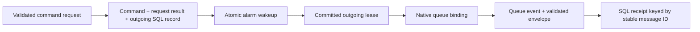

# Automatic SQL outbox and broker pipeline

Owner: `examples/outbox-worker`. Connects [Outbox](outbox.md),
[request replay](idempotency.md), [Object SQL](outbox-sqlite.md),
[native alarms](workers-sqlite-alarms.md), [publisher](workers-outbox-publisher.md)
and [receipt effects](outbox-consumer-deduplication.md).

```sh
pnpm dev:outbox-worker
curl -i http://127.0.0.1:3009/commands \
  -H 'Content-Type: application/json' \
  -d '{"id":"request-123","numbers":[2,4,6]}'
```

The command input's id is a client request key. The server creates a separate UUID
command ID and outgoing message ID. Input is strict: 1–100 finite numbers within
±1e12 and a 1–100-character ASCII request key. Matching keys/input replay the
historical producer response for 24 hours; changed input returns 409. After request
retention expires the key can execute again with new command/message IDs.

The 201 body contains command and delivery; headers provide Location,
Delivery-Location, Receipt-Location and Idempotency-Replayed. Poll the delivery
location for outgoing state, and receipt location for the consumer's persisted
summary. succeeded delivery means broker acceptance/local acknowledgement; a
consumer receipt can appear later. GET /commands/:id retrieves committed business
input. GET /health starts/checks application initialization. Invalid bodies return
400. The outer router does not expose the private /store write route.



CommandStore registers Database -> Outbox/Idempotency services in DI. Its complete
history composes queue, scheduler, alarm, request, outbox index and command schema.
The alarm lists outbox.command.numbers.v1 and processes at most ten records per
invocation. It includes pending/retry/lease deadlines in durable wakeups. Producer
and consumer traces use fixed names and bounded exporters; both flush within the
owning invocation. Application cleanup closes clock, Outbox and database in reverse
order. Object eviction does not promise those application cleanup hooks.

The consumer writes to a separate SQLite receipt Object, using envelope.id as the
primary key. A producer crash after broker acceptance can cause another send with
that ID and another broker delivery ID; the effect remains one receipt.

The local launcher owns Miniflare, bindings and disposal. It defaults to port 3009
and examples/outbox-worker/data/objects. HOST/PORT/OUTBOX_DATA_PATH override local
hosting; DISPATCH_ENABLED=false creates a producer-only host whose committed
outgoing records wait for a later enabled host. On cold local startup the launcher
explicitly activates the known command Object through /health to reconstruct its
alarm. Local broker memory is not promised to survive a whole host restart; the
durable outbox is the recovery source until acceptance is acknowledged. Managed
cloud bindings/deployment remain application-owned. See [native checks](outbox-testing.md).

The full migration history is now owned by src/migrations.ts; its separate
[recovery index](outbox-recovery-migrations.md) follows the deployed command prefix.
Optional [operations routes](outbox-operations-http.md) list delivery metadata and
conditionally retry failed records under their original ID. They remain absent
unless [OUTBOX_OPERATIONS_TOKEN](outbox-operations-authorization.md) is configured.
The existing public routes retain their shared-data policy.

Operations retries now use [transactional audit](outbox-audit-http.md). The complete
history appends its table/indexes after the deployed recovery prefix. Configure
OUTBOX_OPERATIONS_ACTOR for a service label; reason codes are validated and actor
claims cannot be supplied by clients. GET /operations/audit exposes authorized
history. [Audit retention](outbox-audit-retention.md) remains separate host maintenance.
