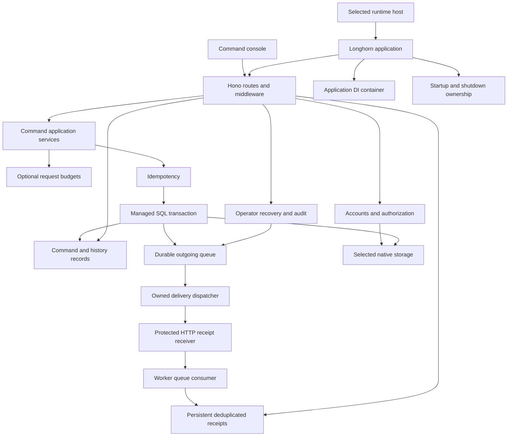
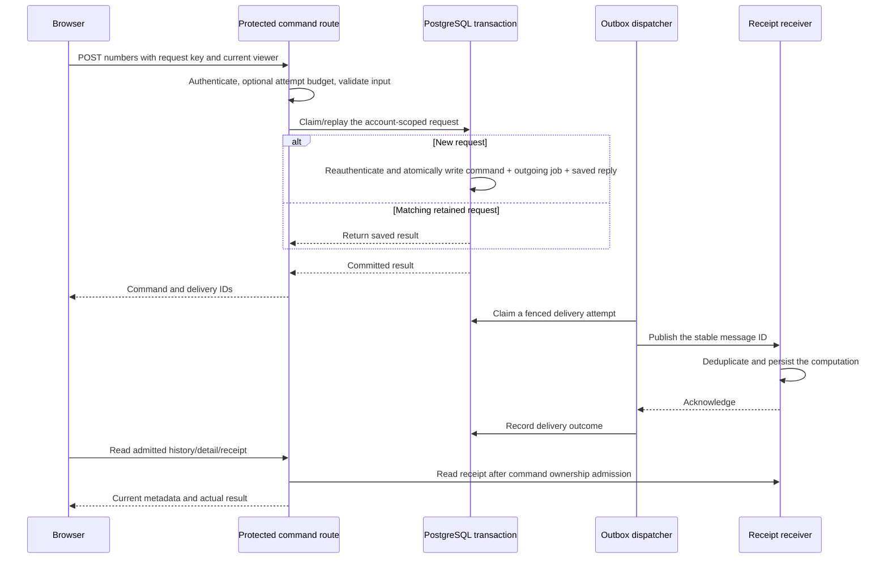

# LongHorn architecture guide

This is the starting point for understanding the whole project as it stands.
LongHorn is a modular TypeScript framework built around Hono, Web Standards,
explicit dependency injection and owned application lifetimes. It includes a
complete command/receipt application that exercises those modules together.

Read the [current handoff](development-handoff.md) for the current state. Use the [feature index](features.md) for individual APIs,
tests and connections, and [detailed architecture](architecture.md) for the
implementation of each subsystem. The code is unpublished;
a working local application does not imply a deployed release.

## The system in one picture



The browser never connects directly to SQL or supplies its account's ownership.
The server authenticates, validates and selects a native provider. A committed
command can outlive the HTTP response and a receiver outage. The receiver stores
its computation independently; the protected reader connects that receipt back
to the admitted command.

## Where the code lives

| Location | Responsibility | Start reading |
| --- | --- | --- |
| packages | Runtime-neutral contracts and feature services | [Feature index](features.md) |
| runtimes | Native listeners, connections, crypto and platform events | [Runtime support](supported-runtimes.md) |
| examples/basic | Persistent task API on Node, shared by native task profiles | [SQLite example](sqlite.md) |
| examples/auth | Native accounts, sessions and private notes | [Auth example](auth-example.md) |
| examples/postgres/src | PostgreSQL app, accounts, commands, schema and hosts | [Composition root](../examples/postgres/src/app.ts) |
| examples/postgres/console | Browser routes, forms, lists and owned read/export controllers | [Web console](web-console.md) |
| examples/outbox-worker | Broker consumer, computation and retained receipts | [Receiver](http-message-receiver.md) |
| examples/jobs and native/rust | Durable report jobs and optional native computation | [Jobs](jobs-example.md), [Rust](rust-reports.md) |
| Other examples | Explicit Redis, D1, Object, schedule, queue and telemetry integrations | [Features](features.md) |
| cli and create-longhorn | CLI, checked snapshots and selected project generation | [CLI](cli.md), [generation](project-generation.md) |
| starters | Editable launchers and local guides copied into generated apps | [Templates](starter-templates.md) |
| scripts | Native engine/browser/crash/installed-app gates and local demos | [Release verification](release-verification.md) |
| docs | Architecture, feature contracts, proof and operating procedures | [This guide](project-guide.md), [handoff](development-handoff.md) |

## Module responsibilities and connections

Core directly depends on container, HTTP, runtime contracts and logger. It does
not automatically install auth, a database, queues or a particular native adapter.
An application imports those optional modules and wires them together.

| Package | What it owns | Connects to |
| --- | --- | --- |
| @longhornjs/core | Longhorn, managed Fetch/background admission, start/listen/close | [Lifecycle](lifecycle.md), [managed work](application-work.md) |
| @longhornjs/container | Typed tokens, factories and application singleton resolution | [DI](dependency-injection.md) |
| @longhornjs/http | Hono creation and HTTP error/not-found defaults | [HTTP](http.md) |
| @longhornjs/runtime | Fetch/listener contracts and optional shared pruning ownership | [Runtimes](runtimes.md), [pruning](prune-worker.md) |
| @longhornjs/validation | Standard Schema parsing and Hono input adapters | [Validation](validation.md) |
| @longhornjs/config | Validated configuration records and merge rules | [Configuration](configuration.md) |
| @longhornjs/logger | Structured records, redaction, Hono correlation and owned export | [Logging](logging.md), [buffering](log-processing.md) |
| @longhornjs/database | SQL values/executors, transaction provenance, schema runners and batch contracts | [Database](database.md), [transactions](transaction-executors.md) |
| @longhornjs/auth | Credentials, password/session policy, guards and explicit account capabilities | [Authentication](authentication.md), [sessions](sessions.md) |
| @longhornjs/events | Awaited process-local typed notifications | [Events](events.md), [subscriptions](event-subscriptions.md) |
| @longhornjs/cache | Memory caching/coalescing/fences and explicit Redis storage/codec | [Cache](cache.md), [Redis](redis-cache.md) |
| @longhornjs/queue | Persistent jobs, claims, leases, retries and consumer workers | [Queues](queues.md), [workers](queue-workers.md) |
| @longhornjs/scheduler | Durable occurrence cursors and atomic queue dispatch | [Scheduling](scheduler.md), [cron](cron.md) |
| @longhornjs/idempotency | Scoped request ownership, input fingerprints and saved JSON results | [Request replay](idempotency.md), [cleanup](idempotency-cleanup.md) |
| @longhornjs/ratelimit | Explicit subject budgets and native reservations | [Limits](request-limits.md), [cleanup](rate-limit-cleanup.md) |
| @longhornjs/outbox | Transactional outgoing jobs, delivery inspection/recovery and audit | [Outbox](outbox.md), [recovery](outbox-deliberate-retry.md) |
| @longhornjs/observability | Readiness/liveness, metrics, explicit trace context and collector export | [Observability](observability.md), [OTLP](otlp-http.md) |

The table is a responsibility map, not a claim that every package depends on all
the others. For example, queue uses database/validation, scheduler adds queue,
and outbox builds on queue and database. Native modules stay outside packages.
Optional provider subpaths keep runtime-specific acquisition separate from the
portable service interfaces.

## Application and resource lifetime

The [Longhorn class](../packages/core/src/application.ts) creates a Hono app and
one application DI container. Middleware makes the same container, logger and
request ID available to each request. DI resolution does not itself imply a new
request scope or automatically close a resource.

1. Validate the host's configuration and select native resource factories.
2. Register services and startup/cleanup hooks before starting the app.
3. Startup acquires resources in order. Hooks return explicit cleanup callbacks.
4. Native listen binds after startup; portable Fetch starts lazily through app.fetch.
5. app.fetch and app.run track accepted HTTP/background promises.
6. Closing stops listeners/admission, drains accepted work and releases startup
   resources in reverse order. Failed startup/binds roll back acquired resources.

For the PostgreSQL app, acquire/check the database before resolving account,
command and background services. Dispatchers/cleanup close before that borrowed
connection. Platform event adapters join their work through the managed lifetime;
Workers does not supply an indefinitely running Node-style server process.

Signals, file/environment access, actual sockets and native child processes belong
to runtime hosts. A runtime registry entry is descriptive metadata, not a process
launcher. [Owned native process](managed-node-process.md) behavior is a separate
Node integration.

## Storage and runtime boundaries

| Runtime/provider | Implemented shape | Important boundary |
| --- | --- | --- |
| Node | Fetch listener; native SQLite/PostgreSQL; native passwords; Redis connection; optional owned processes | Native I/O stays in @longhornjs/node subpaths |
| Bun | Native listener, SQLite and password provider | Uses Bun ownership/crypto, not a Node SQLite alias |
| Deno | Native listener, SQLite and password provider | Launchers supply explicit file/network/environment permissions |
| Workers D1 | Predeclared batch database and task/replay/budget protocols | Does not emulate arbitrary async callback transactions |
| Workers Object SQLite | Managed callback SQLite inside a fixed Object owner | Object input gates, alarms and retained state have platform lifetimes |
| Redis | Explicit cache and request-budget protocols | Native TCP proof is the Node standalone profile; portability is not a multi-runtime TCP guarantee |

SQL providers are explicit dialect implementations, not a SQL translation layer.
SQLite/PostgreSQL callback transactions preserve executor provenance and join
accepted participants. D1 predeclares native batch work with its own atomicity and
positive commit evidence. Services must choose the provider protocol they actually
support. Details and pinned environments live in [supported runtimes](supported-runtimes.md).

Schema manifests are ordered, checksummed histories. Append new migrations after
the application's complete existing profile. Do not rewrite a deployed statement
or insert an upgrade before later application migrations. The persistent PostgreSQL
HTTP role checks the deployed profile; schema ownership belongs to the separate
migration identity. Native examples that migrate during startup document that
specific application policy.

## The command-to-receipt path

The main integration is composed in [app.ts](../examples/postgres/src/app.ts).
[accounts.ts](../examples/postgres/src/accounts.ts) supplies identity;
[operations.ts](../examples/postgres/src/operations.ts) supplies protected commands
and operator routes. [operator-host.ts](../examples/postgres/src/operator-host.ts)
selects persistent configuration, PostgreSQL, native crypto, assets and transport.



The command owns submitted numbers; history supplies bounded metadata. The queue
owns attempts/leases/delivery state. Idempotency owns retained request/result pairs,
not an eternal prohibition on reuse. The receiver owns computation deduplication
and receipts. These stores have independent retention policies.

A failed receiver leaves durable work that can retry. A lost acknowledgement can
repeat delivery, so the stable message ID and receiver's atomic effect deduplication
matter. An operator can deliberately retry a failed delivery under current role
and transaction checks, with an attributed recovery audit. This is not a global
exactly-once network guarantee.

## Accounts, authorization and independent authority

Passwords use explicit native scrypt providers and the shared wire policy. Sessions
use opaque raw tokens in HttpOnly cookies and hash-only native storage. The console
adds its displayed viewer header so a cookie changed in another tab cannot silently
submit/read under a different displayed identity. Origin checks protect mutations;
input schemas reject caller-supplied ownership/role claims.

Password changes and scoped sign-out reauthenticate under native transaction
ownership. Optional [session inventory](session-inventory.md) adds independent
public references and expiry/current markers, without changing old login writers.
A public reference is not a bearer token. Device/IP/creation metadata is not inferred.

The persistent command host opts into password changes, scoped sign-out and
inventory. The temporary demo enables password changes and scoped controls but
currently does not opt into the inventory panel. Capabilities follow the selected
host options; the framework does not turn on every account route globally.

| Identity | Authority |
| --- | --- |
| Member account | Its own commands, notes, named views and admitted sessions |
| numbers-operator account | Explicit application delivery/recovery/audit and deployment-wide history |
| Restricted HTTP database role | Required runtime DML/function execution; no schema ownership |
| Migration/provisioning database owner | Apply complete schema and trusted role grants |
| Separate budget-maintenance database role | Check/prune bounded expired budget rows; no business/HTTP authority |
| Receiver service credential | Protected service protocol; not a user cookie or schema owner |

Live role/session checks remain authoritative. The basic auth example's admin
role and the command app's numbers-operator role are different application policy.
See [viewer binding](console-viewer-binding.md), [runtime grants](runtime-role-grants.md)
and [maintenance authority](command-limit-maintenance-role.md).

## Browser application

The console is bundled TypeScript/CSS with native browser controls. Its route
parser admits validated hash routes and scope/status/ID-prefix selections.
Private rows, cursors and export progress belong to the page rather than browser
storage. Theme preference is the deliberate persistent UI setting.

The implemented browser flows cover account creation/login/settings, command
creation/history/detail, Run again, delivery/receipt following, filters/search,
named views, metadata/receipt/audit downloads and operator recovery. Exports use
bounded serial protected reads and explicit continuation. Detail following owns
its own finite read loop; it does not submit or recover commands automatically.

The [live-history feature](command-history-updates.md) refreshes
complete loaded windows with keyed rows, preserving unrelated input/focus/scroll.
Its pause/budget/cancellation controls are documented separately.

[Console security](console-security.md), [recovery](console-recovery.md) and the
[feature index](features.md) explain the individual controllers. Browser evidence
covers actual Chromium screenshots/AXE and finite flows; physical assistive
technology and other browser engines remain distinct checks.

## Events, cache, background work and diagnostics

- Events are awaited in-process observations. Restart removes their counters and
  subscribers; durable outgoing delivery uses outbox/queue instead.
- Memory cache generations/load coalescing belong to their process. Redis storage
  can be shared, but this does not create distributed loader/version fences.
  Auth and normal owned reads retain their authoritative paths.
- Queue claims use leases and fenced completion; crashed work can be reclaimed.
  Scheduling persists occurrence cursors and atomically enqueues due work. Effects
  still need idempotency. Platform scheduled/queue/alarm adapters have separate
  delivery/acknowledgement contracts.
- Request replay cleanup and budget cleanup are explicit, bounded maintenance.
  Deleting expired metadata does not delete commands/receipts or refill a live
  quota. The command budget maintenance tool owns separate check/once/watch modes.
- Readiness checks explicit dependencies; liveness describes application state.
  Metrics, traces and logs have bounded transport/flush lifetimes. OTLP delivery
  remains best effort without a durable telemetry spool or a full OTel SDK claim.
- Optional Rust computation sits behind a typed authenticated Fetch protocol. It
  computes reports; existing queue/database ownership remains in the application.

Each of these has its own API, provider, lifetime and proof guides in the
[feature index](features.md). They are not implicit side effects of constructing Core.

## Running, packaging and retaining state

From the checkout, the quick command-console demo is:

```sh
pnpm install --frozen-lockfile
pnpm demo:operator-accounts
```

Open http://127.0.0.1:3010/console. Create an account and submit `4, 8, 15`.
The computation returns count 3, sum 27, minimum 4 and maximum 15. This demo's
PostgreSQL/receiver state is temporary. Follow the [walkthrough](command-application.md)
for operator recovery and [persistent host](persistent-operator-host.md) for retention.

Create an independent editable console with the existing template:

```sh
pnpm create:app ../my-console --runtime node --template command-app --install
```

The generated README and docs/setup.md cover migration/runtime roles, receiver,
private profiles and production ingress. The CLI copies a checked local framework
snapshot and only the selected application graph. Creation is not a deployment
or publication. The archive and packed CLI use the same source ownership and are
verified after relocation/frozen installation. See [command projects](command-project.md),
[distribution](command-app-distribution.md) and [source development](command-source-development.md).

Persistent state has two main stores: PostgreSQL and the receiver's retained
Object SQLite directory. [Offline backup](command-app-backup.md) stops writers,
checksums both and restores into new targets with explicit runtime grants. It is
not an online cross-service snapshot or point-in-time recovery system.

## How to read and change the project

For a fresh contributor, read in this order:

1. [Current handoff](development-handoff.md): exact branch, status and evidence.
2. [This guide](project-guide.md): system responsibilities and data flow.
3. [Feature index](features.md): locate the subsystem's API/provider/lifetime guides.
4. [Detailed architecture](architecture.md): the specific implementation section.
5. [Command walkthrough](command-application.md): see the modules working together.
6. [Support matrix](supported-runtimes.md) and [verification](release-verification.md).

For a change, first locate the service contract and its acquisition/lifetime owner.
Keep portable packages free of Node APIs, choose an explicit native provider, keep
Hono policy at the application boundary, and join accepted work before releasing
resources. Add a forward-only schema suffix when needed. Verify the actual native
engine/HTTP/browser or independent artifact relevant to the change. Update its own
Markdown guide and connection links, including any limitations that changed.

Feature development is paused at the owner's request. The [handoff](development-handoff.md)
records the current state without turning documentation status into a release claim.
