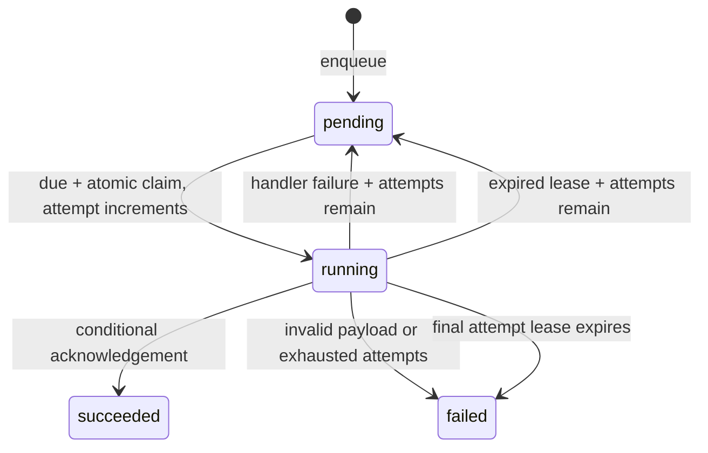

# Durable queues

Owner: `@longhorn/queue`. Connects to [validation](validation.md), [workers](queue-workers.md),
[SQLite storage](queue-sqlite.md), [memory storage](memory-queue.md), and [the report example](jobs-example.md).
The [PostgreSQL provider](queue-postgres.md) connects the same coordinator/worker contracts.
The root module has no Node, HTTP, DI, or database implementation imports. SQL is a separate entrypoint.

## Typed queue

```ts
import { Queue } from '@longhorn/queue'
import { SqliteQueueStore } from '@longhorn/queue/sqlite'
import { z } from 'zod'

const reports = new Queue({
  name: 'reports.v1',
  schema: z.object({ numbers: z.array(z.number().finite()).min(1) }),
  store: new SqliteQueueStore(database), // already migrated, application-owned
})
const job = await reports.enqueue({ numbers: [2, 4, 6] }, {
  delayMs: 0, maxAttempts: 3,
})
const status = await reports.get(job.id)
await reports.runOnce(async (data, context) => {
  // Use context.id as the idempotency key for durable effects.
  await saveReport(context.id, data.numbers)
})
await reports.close()
```

`enqueue` accepts the schema's output type and validates it with Standard Schema.
The normalized output must be finite JSON: null, strings, booleans, numbers, dense
arrays, and plain objects containing those values. Undefined, dates, bigint,
functions, accessors, symbols, cycles, sparse arrays and nesting beyond 64 levels
are rejected. UTF-8 JSON size is bounded by `maxPayloadBytes` (default 65536).
Storage receives a string snapshot; later caller mutations cannot change that string.

Schemas must accept their serialized output on consumption, including after a
restart. Use a stable queue name for each compatible payload/handler version;
introduce `reports.v2` for incompatible changes. Names match `[a-zA-Z0-9._-]{1,100}`.
There is one payload schema and handler contract per name across every producer
and consumer, even when represented by separate Queue instances.

`get` returns metadata only: ID, queue, state, attempt counts, timestamps, current
lease deadline, and the last failure category. Payloads and lease tokens are omitted.
Unknown IDs resolve undefined. Completed/failed records are retained; there is no
automatic retention purge, listing, cancellation or administrative replay API yet.

## State and delivery



`runOnce` claims at most one due job, validates the persisted payload, awaits the
handler, then conditionally completes or fails the claim. It resolves `idle`,
`succeeded`, `retrying`, `failed`, or `lost`, with an ID for non-idle results.
Handler exceptions become `lastFailure: 'handler'`; raw messages, stacks and data
are not persisted. Invalid serialized/schema payloads fail terminally as
`invalid-payload`, without calling the handler. Operational provider errors reject
as `QueueStoreError` with `operation` and `cause`; they are not handler failures.
Handle/log domain errors inside the handler if more diagnostics are needed.

Each claim consumes one attempt, including an attempt interrupted by a crash.
`maxAttempts` defaults to 3 and ranges from 1 to 100. Handler retries use
`min(maxRetryDelayMs, retryDelayMs * 2 ** (attempt - 1))`, measured from failure.
Defaults are 1000 and 60000 ms; zero base delay is allowed. Delays and timestamps
must be nonnegative safe integers. Delayed jobs do not hold a worker slot.

The lease defaults to 30000 ms (minimum 30). Automatic renewal runs approximately
every third of the lease while validation/handler work is active. A failed renewal
aborts the context signal; provider errors are surfaced after the handler settles.
`{ heartbeat: false }` disables renewal for bounded externally managed work/tests.
The final transition joins an in-flight renewal and checks ownership again.

Expiry recovery occurs during the next claim for that queue. Status reads do not
perform recovery, so an abandoned job may show `running` until a consumer polls.
Expired attempts with budget left become available immediately; an expired final
attempt becomes `failed` with `lease-expired`. A unique token fences completion,
failure and renewal from older owners after another consumer claims the job.

This is **at-least-once execution**. A paused or disconnected handler can continue
after losing its lease, and a process can crash after an external effect but before
acknowledgement. The AbortSignal is cooperative. Tokens protect queue state; they
do not fence external systems. Effects need their own idempotency key or transaction.
Queue.enqueue does not join a caller's transaction. The SQLite/PostgreSQL entrypoints expose
insertSqliteJob/insertPostgresJob(executor, input) for caller-owned transactions; the scheduler uses
it to atomically insert occurrences and advance cursors. Automatic business/event
outbox integration remains future work. Retrying an HTTP enqueue creates another job.

## Store and ownership

Queue.prepare(data, { maxAttempts }) performs the same schema/JSON/size validation
as enqueue and returns `{ queue, payload, maxAttempts }` without inserting work.
It participates in queue admission/drain and is used by [schedule registration](scheduler.md).
Prepared strings are snapshots; integrations own durable insertion and need a
provider connected to the same destination database/name/schema as their consumers.

`QueueStore` defines enqueue/get/claim/complete/fail/renew. Implementations must
atomically claim, recover expired attempts, order available due work by availableAt/createdAt/ID,
and condition every running-state mutation on queue, ID, token and an unexpired
lease at the supplied `now`. Low-level metadata inputs are trusted coordinator
inputs; adapters do not repeat every option/schema check. Every consumer of a
durable queue must share the same atomic backing store and compatible settings.
The PostgreSQL provider skips locked rows and bounds recovery to 100 expired rows
per claim; idle is advisory under contention/recovery, so hosts poll again.

Time is supplied by the coordinator, normally Date.now; the injectable `now` is
for deterministic tests. Consumers need synchronized wall clocks. Suspension,
long I/O waits and clock jumps can delay renewal/recovery. Lease timing is not a
hard execution deadline or a guarantee of exclusive external effects.

Queue owns admission and accepted calls, while the host owns the store/connection.
`close` stops new calls and waits for accepted enqueue/get/runOnce operations,
including handlers and their final transitions. It does not close a borrowed
database. Business/provider errors stay on their original calls. Never await
queue/worker/app close inside that queue's handler: cleanup waits for the handler.
Hung handlers keep shutdown pending; host deadlines remain host policy.

## Verification

`queue.test.ts` and `queue.typecheck.ts` cover payload contracts, JSON limits, retry
timing, concurrent claims, stale owners, renewal/abort, provider errors and drain.
`examples/jobs/src/store.test.ts` applies the same behavioral cases to both adapters.
`pnpm test:queues` runs built contracts on Node/Bun/Deno/workerd and verifies real
SQLite consumer processes, forced crashes, heartbeats, HTTP and restart persistence.
The Workers check uses process-local fixture storage and bounded runOnce calls;
it does not claim a durable Cloudflare queue provider exists.

Workers now have two additional explicit boundaries. Existing SQLite queue stores
can persist their lease protocol over [Durable Object SQL](workers-durable-queues.md).
Separately, the [platform queue-event adapter](workers-queue-events.md) consumes
broker batches with [ack/retry decisions](queue-message-decisions.md) and
[bounded batch ownership](queue-batch-lifecycle.md). It does not mirror those
messages into SQL leases. See [the receipt example](queue-worker-example.md) and
[native broker/event verification](workers-queue-testing.md).

`enqueueInTransaction` from `@longhorn/queue/transaction` now publishes through
an active executor belonging to the queue store's database. Business writes and
the validated job commit together; accepted preparation/insertion is joined before
commit. This uses the SQL queue's existing tables, not an external broker outbox.
See [API](transaction-publishing.md), [ownership](transaction-executors.md),
[task/report example](task-report-transactions.md) and [native proof](transaction-publishing-testing.md).

[Outbox](outbox.md) now composes this engine for external broker publication under
a dedicated prefixed queue. Business/outgoing state commits through the same helper,
then a dispatcher publishes outside SQL transactions. Stable envelope IDs and
consumer deduplication handle ambiguous remote acceptance. Existing queue schema,
claims, leases and attempts are reused; optional indexes support bounded retention.
